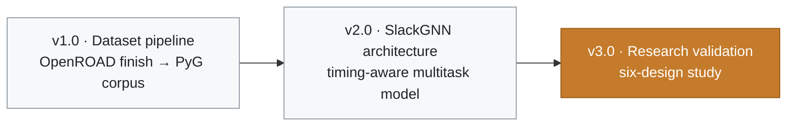

# Changelog

Research release labels. The installable package version in `pyproject.toml` remains 0.1.0 until a maintainer bumps it. Dates below are the year of the work in this repository.

| Release | Theme | Designs |
| --- | --- | --- |
| [v3.0](#v30--research-validation-2026) | Research validation | gcd, aes, ibex, jpeg, riscv32i, chameleon |
| [v2.0](#v20--slackgnn-architecture-2026) | SlackGNN architecture | gcd, aes, ibex, jpeg |
| [v1.0](#v10--dataset-pipeline-2026) | Dataset pipeline | gcd |

---

## v3.0 — Research validation (2026)

Six-design leave-one-design-out study on the SkyWater 130 nm high-density platform.

- **Corpus:** gcd, aes, ibex, jpeg, riscv32i, chameleon. 79,856 nodes, 189,028 edges, 32 published endpoints, 173 expanded route labels.
- **Results:** SlackGNN endpoint means: F1 0.8076, ROC-AUC 0.9583, MAE 0.6919 ns, RMSE 0.8667 ns. Best endpoint F1, ROC-AUC, and MAE among GCN, GraphSAGE, GIN, and SlackGNN.
- **Ablations:** Feature ablations for attention, path membership, timing depth, and edge features.
- **Robustness:** Robustness under sparse labels, label noise, a reduced corpus, and missing paths. Stable through 25% labels. Collapses at 10% labels.
- **Scaling:** Scaling measurements and a 10/20/50-design projection. Runtime follows edge count.
- **Figures:** Publication figures in `reports/figures/publication/`.
- **Papers:** Final research report, executive summary, and research highlights.
- **Packaging:** README, documentation index, project structure, roadmap, contributing guide, and cleanup report.
- **Presentation:** README banner and light/dark architecture figure in `docs/assets/`, Mermaid diagrams across the documentation, and badges. No published number changed.

The earlier four-design tables remain in `reports/m9/` and `README_M9.md`.

## v2.0 — SlackGNN architecture (2026)

Timing-aware model on the published signal-flow graph.

- Structural node features, edge features, logic depth, and reported-path membership.
- Two attention-weighted message-passing layers and a shared embedding.
- Violation head and slack head. Joint loss is binary cross-entropy plus smooth L1.
- Arrival time, required time, and slack withheld from the encoder.
- GCN, GraphSAGE, and GIN baselines on the one-hot node type.
- Training entry point `scripts/train.py`, with explainability rankings and figures.
- First measured rotation covered gcd, aes, ibex, and jpeg.

## v1.0 — Dataset pipeline (2026)

OpenROAD finish artifacts turned into a PyTorch Geometric corpus.

- Curated GCD import: gate-level netlist, SDC, SPEF, and stage timing reports.
- Timing-report parser for startpoint, endpoint, arrival, required, and slack.
- Directed driver-to-load graph extraction from structural Verilog.
- PyG `Data` object per design, with endpoint slack and label masks.
- Corpus publisher under `data/corpus/`.
- OpenROAD-flow-scripts Docker helper `scripts/run_orfs_design.sh` for the sky130hd base flow.
