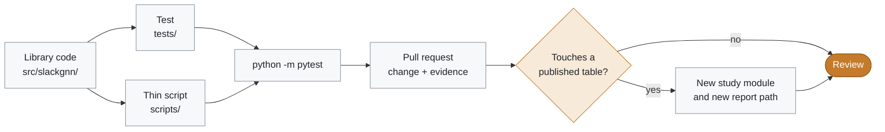

# Contributing

SlackGNN accepts changes that keep the published six-design result interpretable. New code lands in `src/slackgnn` with a thin script and a test. Dataset files and model modules that the v3.0 tables depend on stay as they are unless the pull request is explicitly a new study.



## Environment setup

Python 3.11, from the repository root.

```powershell
py -3.11 -m venv .venv
.\.venv\Scripts\Activate.ps1
python -m pip install --upgrade pip
python -m pip install -r requirements.txt
python -m pip install -e . --no-deps
python scripts\check_python.py
```

On Unix, create the environment with `python3.11 -m venv .venv` and activate it with `source .venv/bin/activate`.

`requirements.txt` and `pyproject.toml` list the same runtime packages: PyTorch, PyTorch Geometric, NetworkX, and matplotlib. pytest is included in `requirements.txt` and as the `test` extra. PyTorch Geometric 2.8 supports PyTorch 2.9 through 2.12. Install a CUDA wheel from the PyTorch selector before `requirements.txt` when the default CPU wheel is the wrong build.

> [!IMPORTANT]
> A new dependency needs a sentence in `docs/` naming the caller, plus matching edits to `pyproject.toml` and `requirements.txt`. Python stays on 3.11 (`requires-python` is `>=3.11,<3.12`).

## Code style

Match the modules already in `src/slackgnn`.

- Library code lives under `src/slackgnn/`. Scripts in `scripts/` parse arguments, configure logging, and call the library.
- Public functions have a docstring. Use type annotations on new signatures.
- Log with the standard `logging` module. Raise a specific exception for a missing design file, and include the path in the message.
- Resolve repository paths through `slackgnn.paths`.
- Arrival time, required time, and slack stay out of encoder inputs.
- Keep the six-design study commands (`generalization_benchmark.py`, `feature_ablation.py`, `robustness_analysis.py`, `scaling_analysis.py`) behaviorally stable. A new experiment gets a new module and a new report path.

There is no separate formatter configuration in this repository. Follow the surrounding file’s import order, quotes, and line length.

## Testing

From the repository root:

```powershell
python -m pytest
```

pytest reads `pythonpath = ["src"]` from `pyproject.toml`, so the suite runs before the editable install. Tests import `slackgnn`. They do not insert `src` onto `sys.path` themselves.

A change to one study can be checked with the matching file:

```powershell
python -m pytest tests/test_generalization.py tests/test_m9_ablation.py tests/test_robustness.py tests/test_scaling.py tests/test_publication.py
```

Dataset pipeline tests include `tests/test_timing_report.py`, `tests/test_netlist_graph.py`, `tests/test_pyg_dataset.py`, and `tests/test_label_expansion.py`.

> [!TIP]
> The full generalization, ablation, robustness, and scaling scripts retrain on the corpus and take minutes. Unit tests are the default check. Retrain when the pull request changes a training default that the published table depends on, and say so in the request.

## Pull requests

This checkout may have no git remote yet. When a remote exists, open the request against the default branch.

- [ ] Describe the user-visible change and the report or test that shows it.
- [ ] Include new tests for new library behavior.
- [ ] Leave generated SPEF files, gate-level netlists other than the curated GCD example, and pickle duplicates off the request. [docs/repository_cleanup_report.md](docs/repository_cleanup_report.md) lists them.
- [ ] Leave `data/corpus/*/graph.pt` unchanged unless the request is a deliberate corpus rebuild, and name the designs that changed.
- [ ] Leave `reports/m9/ablation_results.*`, `robustness_results.*`, `scaling_results.*`, and `cross_design_results.*` as the four-design record. `reports/m9/expanded_labels.pt` is the six-design training target. Write a new comparison table under `reports/` with a new filename.
- [ ] Keep secrets out of the diff. `.env` files are gitignored.

> [!NOTE]
> A documentation-only change still needs a quick read of the linked paths so the README, the final report, and the release notes agree on F1 0.8076, ROC-AUC 0.9583, MAE 0.6919 ns, and RMSE 0.8667 ns.
