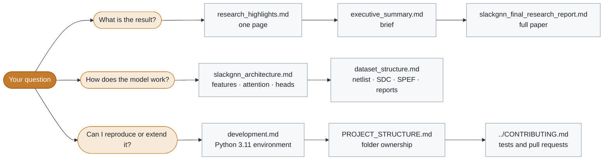
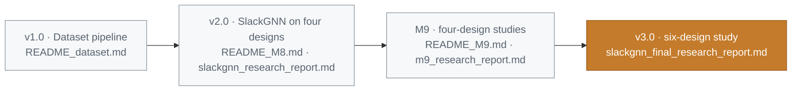

# Documentation index

  
  

The published evaluation is the six-design study. Start with the final report. The earlier four-design write-ups remain in the tree as the record of that experiment.

## Where to start

## Release documents

| Document | What it covers |
| --- | --- |
| [slackgnn_final_research_report.md](slackgnn_final_research_report.md) | Final research report: dataset, model, generalization, ablation, robustness, scaling |
| [executive_summary.md](executive_summary.md) | Brief for hiring managers, EDA engineers, and ML engineers |
| [research_highlights.md](research_highlights.md) | One page: problem, method, results, impact |
| [RELEASE_v3.0.md](RELEASE_v3.0.md) | v3.0 highlights, corpus, figures, limitations, GitHub assets |
| [PROJECT_STRUCTURE.md](PROJECT_STRUCTURE.md) | Folder ownership for `src/`, `scripts/`, `data/`, `reports/`, and `docs/` |
| [repository_cleanup_report.md](repository_cleanup_report.md) | Large artifacts and what stays outside the GitHub source tree |

Repository root companions: [../README.md](../README.md), [../CHANGELOG.md](../CHANGELOG.md), [../ROADMAP.md](../ROADMAP.md), [../CONTRIBUTING.md](../CONTRIBUTING.md).

## Architecture

| Document | What it covers |
| --- | --- |
| [slackgnn_architecture.md](slackgnn_architecture.md) | Feature channels, attention message passing, multitask heads, leakage rule |
| [dataset_structure.md](dataset_structure.md) | GCD finish layout: netlist, SDC, SPEF, timing reports |
| [development.md](development.md) | Python 3.11 environment, directory ownership, dependency policy |

> [!NOTE]
> `slackgnn_architecture.md` describes the model. Its leave-one-design-out sentence names the earlier four-design rotation. The six-design protocol and scores are in the final research report.

Architecture figures for decks and the repository page live in [assets/](assets/): `architecture.png`, `architecture-dark.png`, and the social-preview `banner.png`, each with its SVG source.

## Study reports

| Study | Narrative | Tables |
| --- | --- | --- |
| Generalization | Final report, section 8 | [../reports/generalization_results.md](../reports/generalization_results.md) |
| Ablation | Final report, section 9 | [../reports/ablation_results.md](../reports/ablation_results.md) |
| Robustness | [slackgnn_robustness_analysis.md](slackgnn_robustness_analysis.md) | [../reports/robustness_results.md](../reports/robustness_results.md) |
| Scaling | [slackgnn_scaling_analysis.md](slackgnn_scaling_analysis.md) | [../reports/scaling_results.md](../reports/scaling_results.md) |
| Publication figures | [../reports/publication_figures.md](../reports/publication_figures.md) | `reports/figures/publication/` |

## Earlier experiment

> [!WARNING]
> These files record the four-design run on gcd, aes, ibex, and jpeg. They are the history of that run. The six-design numbers live in the final report and in `reports/generalization_results.md`.

| Document | What it covers |
| --- | --- |
| [m9_research_report.md](m9_research_report.md) | Four-design M9 narrative |
| [slackgnn_research_report.md](slackgnn_research_report.md) | Earlier research note |
| [slackgnn_next_phase.md](slackgnn_next_phase.md) | Note written by the baseline trainer |
| [../README_M8.md](../README_M8.md) | SlackGNN architecture phase on four designs |
| [../README_M9.md](../README_M9.md) | Four-design label expansion and studies |
| [../README_dataset.md](../README_dataset.md) | How the curated GCD finish was imported |

