<p align="center">
  
</p>

<p align="center">
  <b>Timing-aware graph neural networks for OpenROAD timing prediction.</b><br>
  Predict endpoint timing violations and slack on a placed-and-routed netlist the model has never seen.
</p>

<p align="center">
  <a href="docs/RELEASE_v3.0.md"></a>
  <a href=".python-version"></a>
  <a href="requirements.txt"></a>
  <a href="requirements.txt"></a>
  <a href="https://github.com/The-OpenROAD-Project"></a>
  <a href="docs/dataset_structure.md"></a>
  <a href="CONTRIBUTING.md#testing"></a>
  <a href="#license"></a>
</p>

<p align="center">
  <a href="#results"></a>
  <a href="#results"></a>
  <a href="#results"></a>
  <a href="#results"></a>
</p>

<p align="center">
  <a href="#the-problem">Problem</a> ·
  <a href="#how-it-works">How it works</a> ·
  <a href="#how-it-is-tested">Protocol</a> ·
  <a href="#results">Results</a> ·
  <a href="#what-carries-the-gain">Ablations</a> ·
  <a href="#how-far-the-result-holds">Robustness &amp; scaling</a> ·
  <a href="#quick-start">Quick start</a> ·
  <a href="#documentation">Docs</a>
</p>

---

## At a glance

SlackGNN estimates timing slack on a placed-and-routed netlist it has never trained on. It reads a directed gate-level graph from an OpenROAD finish, then predicts two values at each published endpoint: whether the endpoint violates its clock, and the slack in nanoseconds.

| Aspect | Detail |
| --- | --- |
| **Corpus** | 6 OpenROAD designs on SkyWater 130 nm high-density (`sky130hd`): gcd, aes, ibex, jpeg, riscv32i, chameleon |
| **Graph** | 79,856 nodes · 189,028 driver-to-load edges |
| **Supervision** | 32 published timing endpoints · 173 expanded route labels |
| **Protocol** | Leave-one-design-out · seed 0 · hidden width 32 · epoch cap 20 · patience 6 · CPU |
| **Headline** | SlackGNN **F1 0.8076** · **ROC-AUC 0.9583** · **MAE 0.6919 ns** · **RMSE 0.8667 ns** |
| **Compared with** | GCN, GraphSAGE, GIN on the same splits. SlackGNN has the best endpoint F1, ROC-AUC, and MAE |

> [!IMPORTANT]
> These 32 endpoints can rank the four architectures. Certifying a clock remains the job of the timer. SlackGNN is a screening model that sits beside static timing analysis, not inside signoff.

**Read next:** the full paper is [docs/slackgnn_final_research_report.md](docs/slackgnn_final_research_report.md). A short brief for engineers and hiring managers is [docs/executive_summary.md](docs/executive_summary.md).

---

## The problem

Static timing analysis answers the clock question for the paths it reports. A finish report from a production flow prints a small set of those paths. Across this corpus that set is **32 endpoints on 79,856 gates**, a supervision rate of about 0.04%.

A model that sees only those endpoints, and that is tested on a design it never trained on, has to transfer timing behavior through circuit structure. Three traps shape every design decision in this repository:

| Trap | What goes wrong | What SlackGNN does |
| --- | --- | --- |
| **Leakage** | Arrival time and required time determine slack, so a model that reads them can reconstruct the label by arithmetic | Arrival time, required time, and slack are supervision targets. They stay out of the encoder |
| **Split** | Endpoints from one design on both sides of a random split share cones of logic | Leave-one-design-out: the held-out design contributes no training labels |
| **Label poverty** | Four to seven endpoints per design make F1 jump when one endpoint flips | Report ROC-AUC and MAE beside F1, plus per-design tables |

---

## How it works

### From RTL to a graph dataset

Each design runs through OpenROAD-flow-scripts. The finish netlist becomes the graph. The finish timing report becomes the labels. The constraints and parasitics are kept with each design.

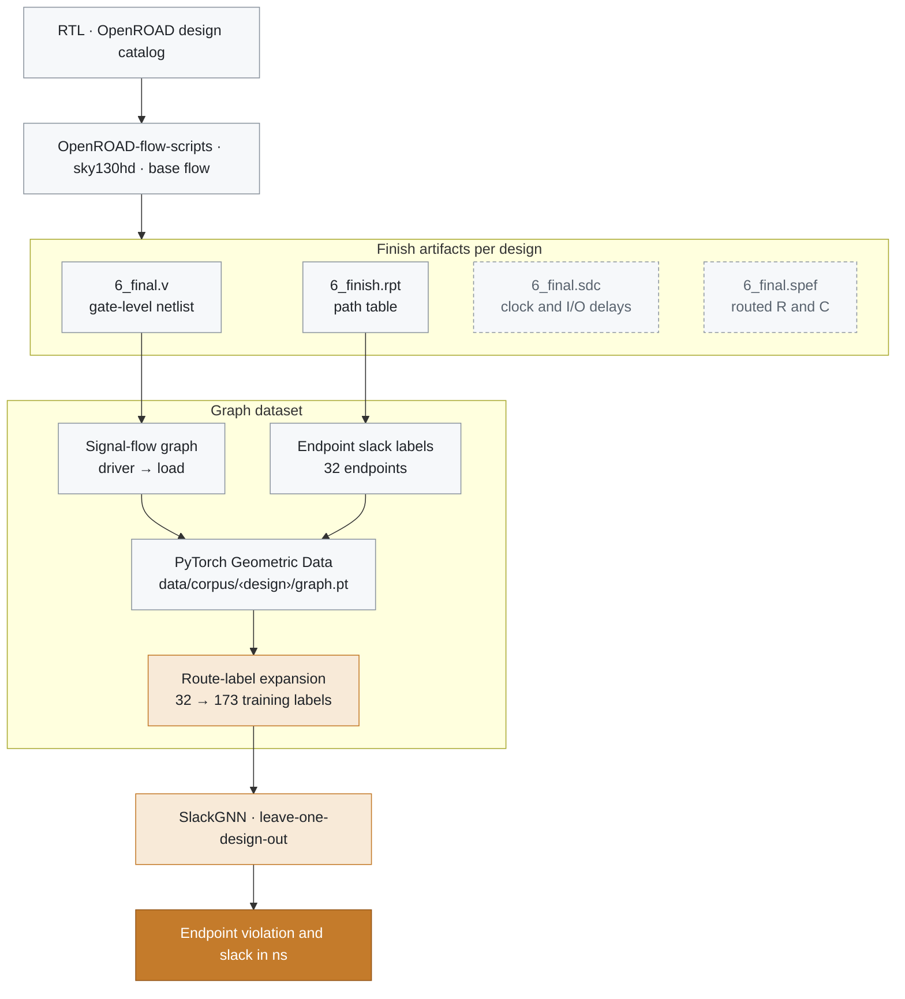

<sub>Dashed boxes are stored with each design and are not read by the v3.0 encoder.</sub>

| Step | Command | Output |
| --- | --- | --- |
| Run one design through the flow | `scripts/run_orfs_design.sh` | OpenROAD-flow-scripts design in Docker |
| Parse, extract, label, convert | `scripts/process_design.py` | `data/<design>/pyg/graph.pt` from `netlist/6_final.v` and `reports/6_finish.rpt` |
| Publish the corpus | `scripts/build_corpus.py` | `data/corpus/<design>/` |
| Expand route labels | `scripts/expand_labels.py` | `reports/m9/expanded_labels.pt` |

### Growing supervision without inventing measurements

The finish report prints slack at endpoints only. Route-label expansion copies each reported slack along the shortest signal-flow route from the reported startpoint to its endpoint, so the training loss sees more than the single endpoint pin.

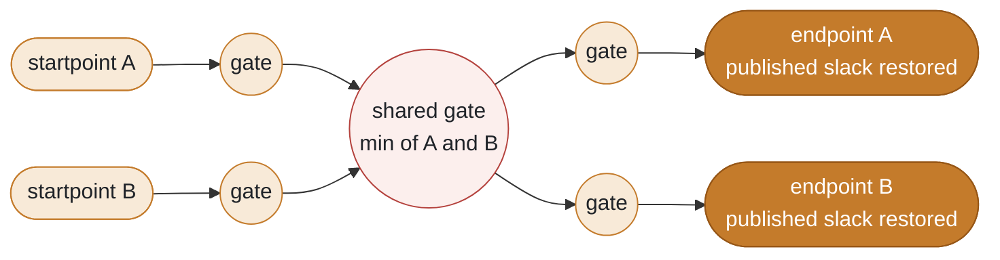

- Shared nodes keep the minimum slack of the routes that touch them.
- The published endpoint slack is restored afterward, so the endpoint row still matches the path table.
- Expansion lifts training labels from 32 to 173. **Evaluation returns to the 32 published endpoints**, so a good expanded-label score cannot replace a good endpoint score.

> [!NOTE]
> Copied slack is not a new static-timing measurement. Expanded metrics describe the training target. The endpoint table is the result.

### The model

SlackGNN is a node-level network on the driver-to-load graph. Message passing runs on every gate. The loss uses labeled nodes.

<p align="center">
  <picture>
    <source media="(prefers-color-scheme: dark)" srcset="docs/assets/architecture-dark.png">
    
  </picture>
</p>

- **Inputs.** Structural node features, edge features, logic depth, and reported-path membership. The edge delay channel is `log1p(driver fanout)`, normalized inside the design. SPEF resistance and capacitance are stored with the design and are withheld from this encoder.
- **Message passing.** Two attention-weighted message-passing layers aggregate drivers into each load. Scores are softmax-normalized over the drivers of each load.
- **Heads.** A shared embedding feeds a violation head and a slack head. The training loss is binary cross-entropy plus smooth L1, with weights 1.0 and 0.5.
- **Baselines.** GCN, GraphSAGE, and GIN use the published one-hot node type, with separate classification and regression heads.

<details>
<summary><b>Text-native version of the architecture (Mermaid)</b></summary>

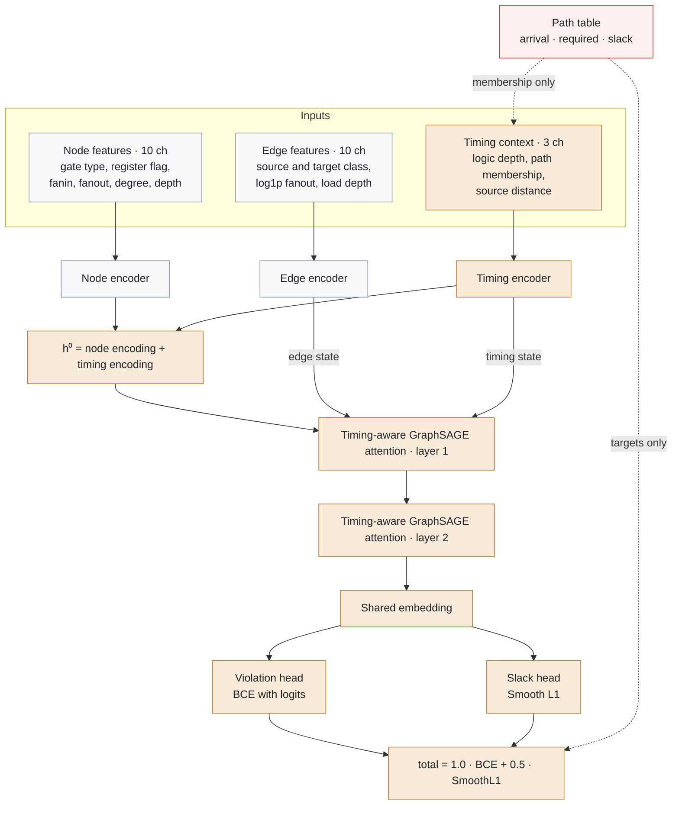

<sub>The edge and timing states feed the attention scorer of both layers.</sub>

</details>

Feature tables, the attention scorer, and the loss are in [docs/slackgnn_architecture.md](docs/slackgnn_architecture.md).

---

## How it is tested

Leave-one-design-out is the evaluation. Each design is held out once. Training uses the other designs. Test scores use the published path-table slack of the held-out design.

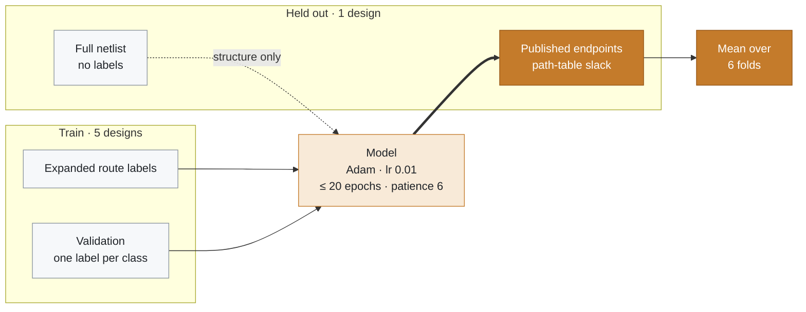

- The held-out design contributes no training rows. Message passing still runs on its full netlist, because an unlabeled gate can carry structural context to a labeled endpoint.
- Classification class 1 is a timing violation (slack strictly below zero). Regression scores slack in nanoseconds.
- F1 means skip a holdout when the model predicts no violations. ROC-AUC and MAE are defined on every holdout.

---

## Results

Leave-one-design-out endpoint means. Seed 0, hidden width 32, epoch cap 20, patience 6. F1 means skip a holdout when the model predicts no violations.

| Model | F1 ↑ | ROC-AUC ↑ | MAE (ns) ↓ | RMSE (ns) ↓ |
| --- | ---: | ---: | ---: | ---: |
| GCN | 0.5800 | 0.6243 | 0.9621 | 1.1922 |
| GraphSAGE | 0.3333 | 0.7632 | 0.8704 | 1.1053 |
| GIN | 0.5222 | 0.6951 | 0.9470 | 1.1712 |
| **SlackGNN** | **0.8076** | **0.9583** | **0.6919** | **0.8667** |

<p align="center">
  
  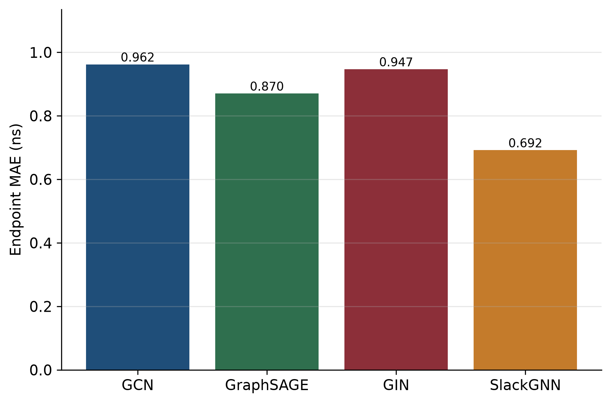
</p>

SlackGNN has the best endpoint F1, the best ROC-AUC, and the best MAE. The F1 gap from the next defined baseline mean, GCN at 0.5800, is 0.2276. The ROC-AUC gap from the next baseline, GraphSAGE at 0.7632, is 0.1951. The MAE gap from GraphSAGE, the best baseline on error, is 0.1785 ns.

> [!NOTE]
> **Reading the F1 column.** GraphSAGE's F1 of 0.3333 is the chameleon holdout. The other GraphSAGE folds predict no violations, so their F1 is undefined and is omitted from that mean. SlackGNN's endpoint F1 is undefined on aes for the same reason. On aes, SlackGNN ROC-AUC is 1.0 and MAE is 0.2578 ns. Even looking only at ROC-AUC and MAE, which are defined everywhere, SlackGNN leads.

### Per held-out design

| Held-out | Support | F1 | ROC-AUC | MAE (ns) | RMSE (ns) |
| --- | ---: | ---: | ---: | ---: | ---: |
| gcd | 5 | 0.8000 | 1.0000 | 0.7045 | 0.8072 |
| aes | 4 | n/a | 1.0000 | 0.2578 | 0.2832 |
| ibex | 7 | 0.6667 | 1.0000 | 1.3993 | 1.8235 |
| jpeg | 6 | 1.0000 | 1.0000 | 0.9296 | 1.2074 |
| riscv32i | 4 | 1.0000 | 1.0000 | 0.2785 | 0.3401 |
| chameleon | 6 | 0.5714 | 0.7500 | 0.5815 | 0.7392 |

Five of the six holdouts have ROC-AUC 1.0. ibex is the expensive holdout for slack error: the model orders its endpoints and still misses their magnitudes by more than a nanosecond on average.

aes is the easiest holdout by mean defined endpoint F1 (0.8333). ibex is the hardest (0.4667).

<p align="center">
  
</p>

<details>
<summary><b>Expanded-route labels</b></summary>

On expanded-route labels, GraphSAGE F1 is 0.8094 and SlackGNN F1 is 0.7955. SlackGNN reaches expanded ROC-AUC 0.9027 and MAE 0.6848 ns. GraphSAGE reaches ROC-AUC 0.8082 and MAE 0.7431 ns. The expanded F1 edge for GraphSAGE is consistent with copied labels being a smoother target that a plain neighborhood aggregator can fit. Endpoint ranking and slack error still favor SlackGNN.

</details>

<details>
<summary><b>All publication figures</b></summary>

| | |
| :---: | :---: |
| 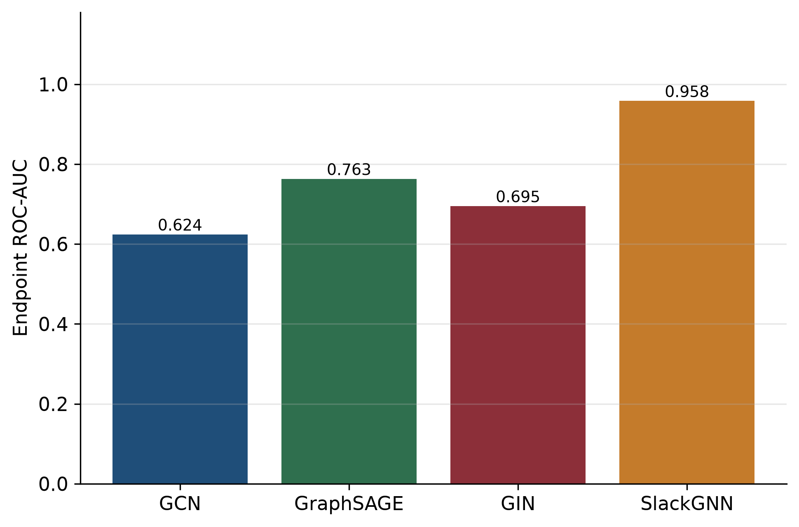 | 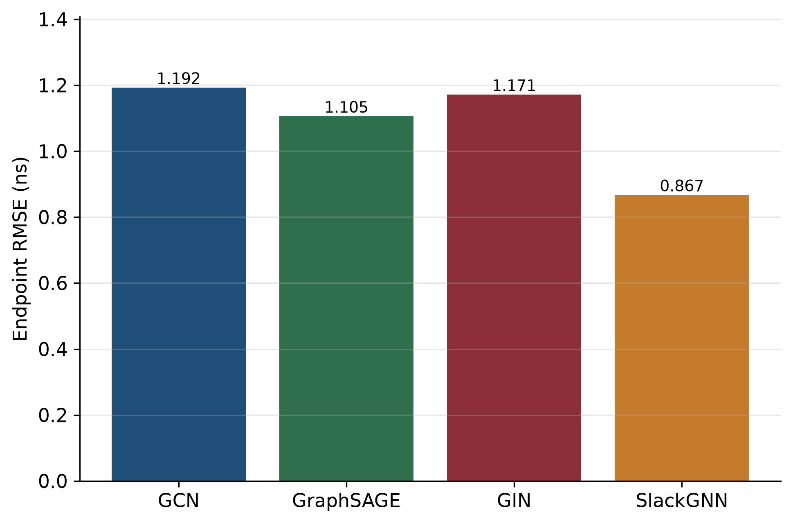 |
| Endpoint ROC-AUC | Endpoint RMSE |
| 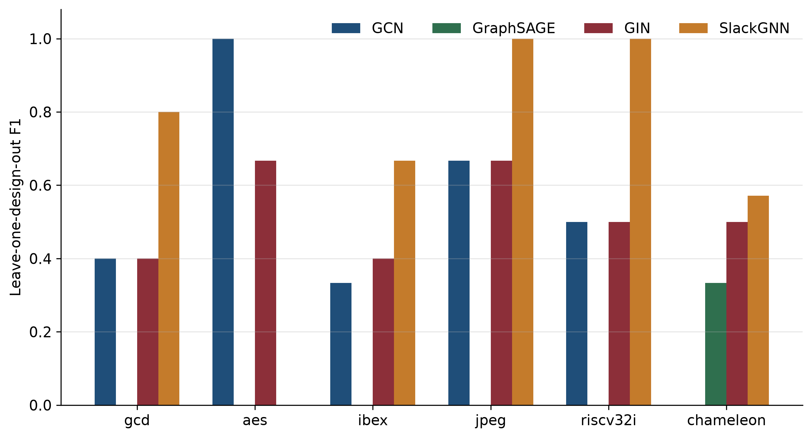 | 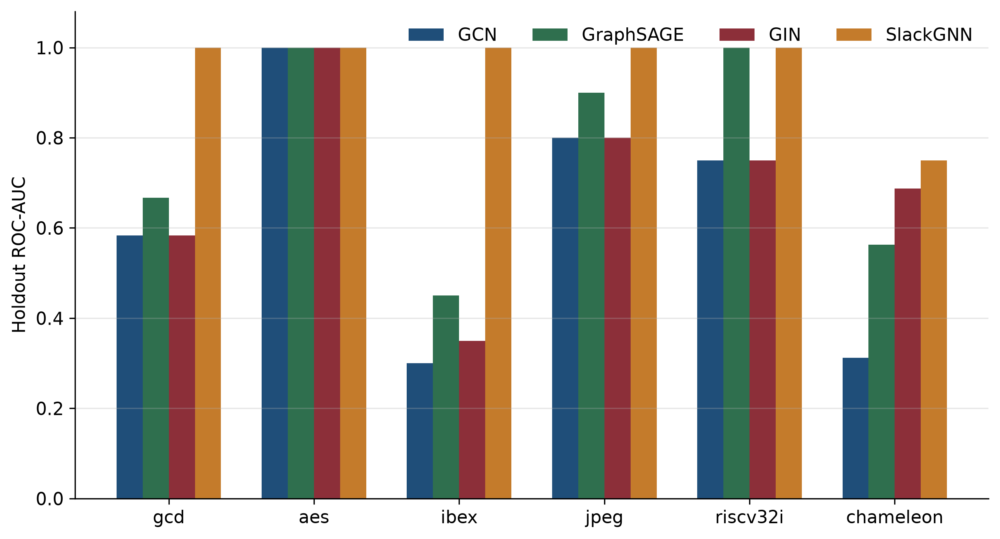 |
| Leave-one-design-out F1 | Holdout ROC-AUC |
| 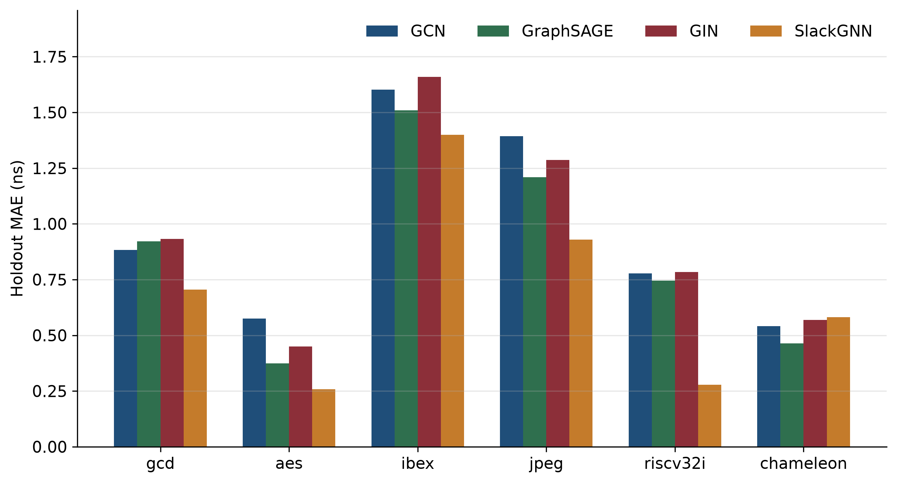 | 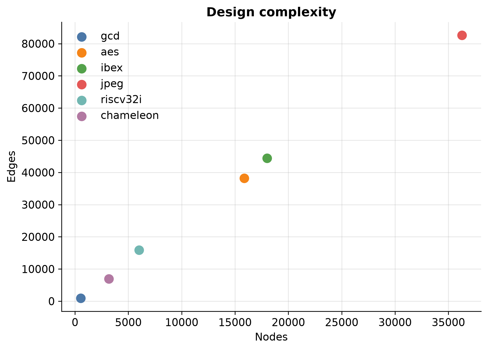 |
| Holdout MAE | Design complexity |

Index: [reports/publication_figures.md](reports/publication_figures.md). Numerical source: [reports/generalization_results.md](reports/generalization_results.md).

</details>

---

## What carries the gain

The ablation retrains the full SlackGNN protocol and four controlled removals. The full model reproduces the generalization numbers exactly.

| Variant | F1 | ROC-AUC | MAE (ns) | RMSE (ns) | F1 change | MAE change (ns) |
| --- | ---: | ---: | ---: | ---: | ---: | ---: |
| Full SlackGNN | 0.8076 | 0.9583 | 0.6919 | 0.8667 |  |  |
| No attention | 0.8343 | 0.9139 | 0.6464 | 0.8384 | +0.0267 | −0.0455 |
| No path membership | 0.7886 | 0.9514 | 0.7080 | 0.8773 | −0.0190 | +0.0162 |
| No timing criticality | 0.8933 | 0.8722 | 0.7360 | 0.8925 | +0.0857 | +0.0441 |
| No edge features | 0.8952 | 0.9583 | 0.6547 | 0.8379 | +0.0876 | −0.0372 |

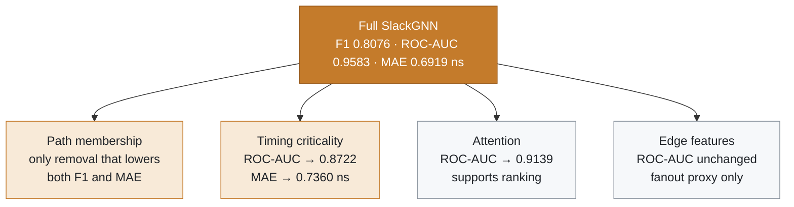

Path membership is the only removal that lowers both endpoint F1 and endpoint MAE. Timing criticality (logic depth and source distance) is doing ranking and calibration. Attention helps ranking. The current edge features are not the source of the endpoint ROC-AUC.

> [!TIP]
> F1 changes in the ablation table inherit the undefined-fold issue: part of an F1 increase is a change in which designs enter the mean. ROC-AUC and MAE do not have that ambiguity, and they are the basis for the criticality and attention conclusions. Details: [docs/slackgnn_final_research_report.md §9](docs/slackgnn_final_research_report.md#9-ablation-results).

---

## How far the result holds

### Robustness

SlackGNN remains ahead of GCN, GraphSAGE, and GIN when labels are thinned, noised, or drawn from fewer reported paths.

| Condition | Holds through | Collapses at |
| --- | --- | --- |
| Sparse labels | 25% of the expanded labels (F1 0.8250, ROC-AUC 0.8097, MAE 0.7930 ns) | 10% labels (F1 0.6143, ROC-AUC 0.7264, MAE 0.9282 ns) |
| Label noise | 20% noise (F1 0.8200, ROC-AUC 0.9514, MAE 0.7497 ns) | no tested setting |
| Missing paths | 50% of training paths removed (F1 0.9000, ROC-AUC 0.9236, MAE 0.7210 ns) | no tested setting |
| Corpus size | 6 designs are the smallest stable corpus | 4 designs (F1 0.6750, MAE 0.9890 ns) |

Across the degraded conditions, mean endpoint F1 is 0.8022 for SlackGNN, 0.5046 for GIN, 0.4942 for GCN, and 0.4245 for GraphSAGE.

<p align="center">
  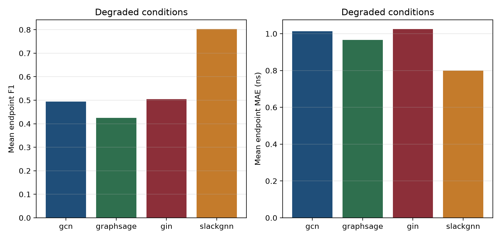
</p>

> [!TIP]
> Path deletion barely moves the model. A new design helps the corpus when its finish report adds endpoints. A larger netlist whose report reprints the same few paths adds edges and adds little supervision.

### Scaling

| Model | Training time (s) | Inference time (s) | PyTorch step (MB) |
| --- | ---: | ---: | ---: |
| GCN | 29.39 | 0.0428 | 14.37 |
| GraphSAGE | 26.21 | 0.0253 | 19.60 |
| GIN | 43.84 | 0.0306 | 19.33 |
| SlackGNN | 67.61 | 0.1647 | 50.97 |

Training time follows edge count more closely than node count. The mean log-log slope against edges is 0.45. jpeg accounts for about 38% of a SlackGNN epoch, and the backward pass is the heavier part. A full six-design holdout is about 1.1 minutes on the measured CPU. A linear projection to 50 average-sized designs is about 92 minutes if every fold still runs 20 epochs.

Full analyses: [robustness](docs/slackgnn_robustness_analysis.md) · [scaling](docs/slackgnn_scaling_analysis.md).

---

## Corpus

| Design | Nodes | Edges | Endpoints | Met | Violations | Expanded labels |
| --- | ---: | ---: | ---: | ---: | ---: | ---: |
| gcd | 527 | 928 | 5 | 3 | 2 | 27 |
| aes | 15,868 | 38,215 | 4 | 3 | 1 | 20 |
| ibex | 18,000 | 44,436 | 7 | 5 | 2 | 42 |
| jpeg | 36,283 | 82,643 | 6 | 5 | 1 | 23 |
| riscv32i | 5,997 | 15,884 | 4 | 2 | 2 | 33 |
| chameleon | 3,181 | 6,922 | 6 | 4 | 2 | 28 |
| **Total** | **79,856** | **189,028** | **32** | **22** | **10** | **173** |

`data/designs.json` also names uart and spi. Those two designs are absent from the measured corpus.


---

## Quick start

### Installation

Python 3.11. PyTorch Geometric 2.8 sets the PyTorch window at 2.9 through 2.12. The published measurements used a CPU wheel.

From the repository root:

```powershell
py -3.11 -m venv .venv
.\.venv\Scripts\Activate.ps1
python -m pip install --upgrade pip
python -m pip install -r requirements.txt
python -m pip install -e . --no-deps
python scripts\check_python.py
```

Unix activation is `source .venv/bin/activate`. Create that environment with `python3.11 -m venv .venv`.

A CUDA wheel, when required, comes from the [PyTorch install selector](https://pytorch.org/get-started/locally/) before `requirements.txt`. Contributor workflow is in [docs/development.md](docs/development.md).

### Smoke test

```powershell
python scripts\check_python.py
python -m pytest
python scripts\corpus_summary.py
```

`corpus_summary.py` reads `data/corpus/corpus_metadata.json` and checks that each published design still has `graph.pt`. The pytest suite uses `pythonpath = ["src"]` from `pyproject.toml`.

### Training

The published leave-one-design-out comparison trains GCN, GraphSAGE, GIN, and SlackGNN at seed 0, hidden width 32, and an epoch cap of 20:

```powershell
python scripts\expand_labels.py
python scripts\generalization_benchmark.py
```

`expand_labels.py` is required once. The benchmark reads `reports/m9/expanded_labels.pt` and writes `reports/generalization_results.json` and `reports/generalization_results.md`. On this corpus the protocol training time is on the order of a few minutes on CPU.

`scripts/train.py` is the single-model entry point. Its default epoch cap is 30.

```powershell
python scripts\train.py --model slackgnn --task multitask --epochs 20 --hidden 32 --seed 0
python scripts\train.py --model gcn --epochs 20 --hidden 32 --seed 0
```

`--task` accepts `classification`, `regression`, or `multitask`. `--alpha` and `--beta` default to 1.0 and 0.5.

### Evaluation

Published metrics already live under `reports/`. Recomputing them retrains the same protocol:

```powershell
python scripts\generalization_benchmark.py
python scripts\feature_ablation.py
python scripts\robustness_analysis.py
python scripts\scaling_analysis.py
python scripts\publication_figures.py
```

| Command | Writes |
| --- | --- |
| `generalization_benchmark.py` | `reports/generalization_results.md` |
| `feature_ablation.py` | `reports/ablation_results.md` |
| `robustness_analysis.py` | `reports/robustness_results.md` |
| `scaling_analysis.py` | `reports/scaling_results.md` |
| `publication_figures.py` | `reports/figures/publication/` |

---

## Who this is for

| Reader | What to take from it | Start with |
| --- | --- | --- |
| **EDA engineers** | A fast screen for which unseen blocks look timing-critical before a full path report is read | [Executive summary](docs/executive_summary.md) |
| **ML engineers** | A reproducible graph-learning benchmark: directed netlists, a leakage rule, a design holdout, and published tables for generalization, ablation, robustness, and scaling | [Final research report](docs/slackgnn_final_research_report.md) |
| **Hiring managers** | An end-to-end ML-for-EDA project: an OpenROAD corpus, a graph dataset, a multitask model, controlled ablations, and an explicit statement of what the evidence does not support | [Research highlights](docs/research_highlights.md) |

---

## Documentation

| Document | Role |
| --- | --- |
| [docs/slackgnn_final_research_report.md](docs/slackgnn_final_research_report.md) | Full paper |
| [docs/executive_summary.md](docs/executive_summary.md) | One-to-two page brief |
| [docs/research_highlights.md](docs/research_highlights.md) | One-page highlights |
| [docs/slackgnn_architecture.md](docs/slackgnn_architecture.md) | Feature channels, attention, heads, leakage rule |
| [docs/RELEASE_v3.0.md](docs/RELEASE_v3.0.md) | Release notes |
| [docs/INDEX.md](docs/INDEX.md) | Documentation index |

`README_M9.md` and `docs/m9_research_report.md` record the earlier four-design experiment (gcd, aes, ibex, jpeg). The six-design table in this README is the published result.

## Repository structure

```text
src/slackgnn/     library: dataset, features, models, studies
scripts/          command-line entry points
tests/            pytest suite
data/             designs, finish artifacts, published graphs
reports/          metrics, JSON, and figures
docs/             papers, architecture, and release notes
tcl/              EDA helper scripts
notebooks/        local exploration
results/          local experiment outputs
```

Folder ownership is in [docs/PROJECT_STRUCTURE.md](docs/PROJECT_STRUCTURE.md). Files that stay off GitHub are listed in [docs/repository_cleanup_report.md](docs/repository_cleanup_report.md).

---

## What the evidence does not support

> [!CAUTION]
> - **Signoff.** Thirty-two endpoints can rank these models. Certifying a clock remains the job of static timing analysis.
> - **Seed variance.** One seed. A second seed is future work.
> - **Other technologies.** One PDK: sky130hd. Cross-technology transfer is a hypothesis.
> - **Parasitics.** SPEF is stored with each design and is withheld from the edge encoder. The delay channel is normalized `log1p(driver fanout)`.
> - **Label floor.** The model collapses at 10% of the expanded labels. Six designs are the smallest corpus that keeps slack error within 0.10 ns of the full result under the study's stability rule.

## Roadmap

- More designs, including the uart and spi names already listed in `data/designs.json`
- More printed endpoints, so the label set can grow past 173
- A second PDK beside sky130hd
- Richer edge features
- A SPEF-aware encoder that joins resistance and capacitance into the edge channels

The milestone list is [ROADMAP.md](ROADMAP.md). Release history is [CHANGELOG.md](CHANGELOG.md). Contribution rules are [CONTRIBUTING.md](CONTRIBUTING.md).

## Citation

The Python package version in `pyproject.toml` is 0.1.0. This research release is labeled v3.0.

```bibtex
@software{slackgnn2026,
  title        = {SlackGNN: Timing-Aware Graph Neural Networks for OpenROAD Timing Prediction},
  year         = {2026},
  version      = {3.0},
  howpublished = {Research release}
}
```

## License

This repository has no `LICENSE` file yet. Until a maintainer adds one, GitHub does not grant a license to reuse the code. Choose a license and add it before the first public push.
