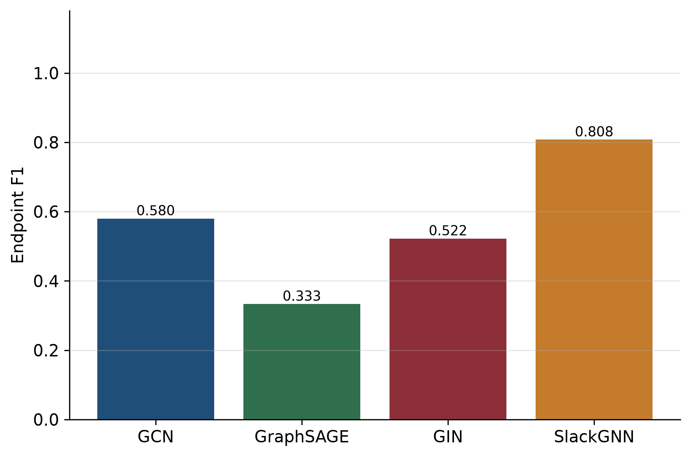
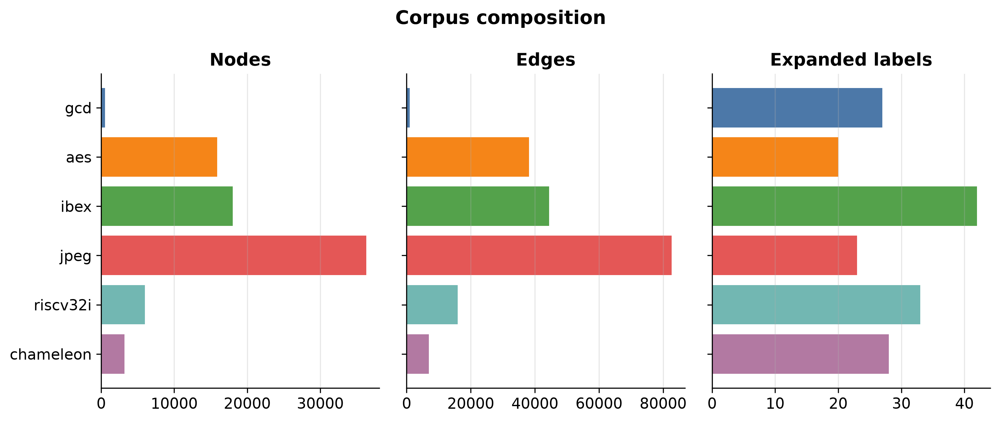
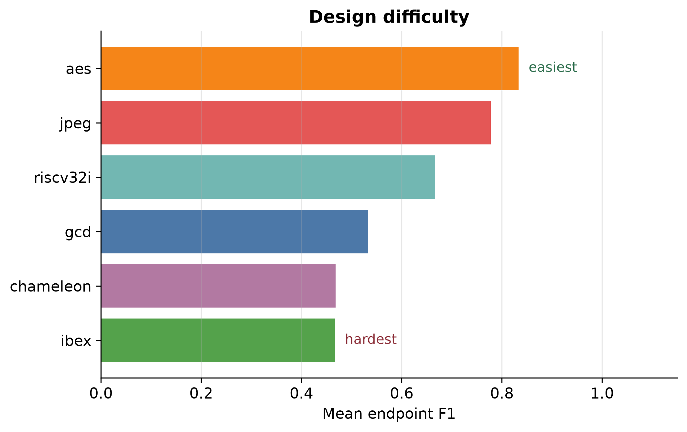

# SlackGNN

## Project overview

SlackGNN estimates timing slack on a placed-and-routed netlist it has never trained on. It reads a directed gate-level graph from an OpenROAD finish, then predicts two values at each published endpoint: whether the endpoint violates its clock, and the slack in nanoseconds.

The published study uses six designs on the SkyWater 130 nm high-density platform (`sky130hd`): gcd, aes, ibex, jpeg, riscv32i, and chameleon. Together they contain 79,856 nodes, 189,028 driver-to-load edges, 32 published timing endpoints, and 173 expanded route labels.

On those endpoints, SlackGNN records **F1 0.8076**, **ROC-AUC 0.9583**, **MAE 0.6919 ns**, and **RMSE 0.8667 ns**. The full write-up is [docs/slackgnn_final_research_report.md](docs/slackgnn_final_research_report.md). A short brief for engineers and hiring managers is [docs/executive_summary.md](docs/executive_summary.md).



## Motivation

Static timing analysis answers the clock question for the paths it reports. A finish report from a production flow prints a small set of those paths. Across this corpus that set is 32 endpoints on 79,856 gates. A model that sees only those endpoints, and that is tested on a design it never trained on, has to transfer timing behavior through circuit structure.

Leave-one-design-out is the evaluation. Each design is held out once. Training uses the other designs. Test scores use the published path-table slack of the held-out design. Arrival time, required time, and slack are supervision targets. They stay out of the encoder.

## Architecture overview

SlackGNN is a node-level network on the driver-to-load graph. Message passing runs on every gate. The loss uses labeled nodes.

The encoder reads structural node features, edge features, logic depth, and reported-path membership. Two attention-weighted message-passing layers aggregate drivers into each load. A shared embedding feeds a violation head and a slack head. The training loss is binary cross-entropy plus smooth L1, with weights 1.0 and 0.5.

The edge delay channel is `log1p(driver fanout)`, normalized inside the design. SPEF resistance and capacitance are stored with the design and are withheld from this encoder.

GCN, GraphSAGE, and GIN baselines use the published one-hot node type, with separate classification and regression heads.

The module diagram and feature tables are in [docs/slackgnn_architecture.md](docs/slackgnn_architecture.md).

```text
node features ---- node encoder ----+
timing context --- timing encoder --+--> attention layers --> violation logit
edge features ---- edge encoder ----+                      --> slack (ns)
```

## End-to-end workflow

```text
RTL
  → OpenROAD-flow-scripts (sky130hd, base)
  → finish netlist, constraints, SPEF, and timing reports
  → graph extraction (driver → load)
  → PyTorch Geometric Data
  → route-label expansion
  → SlackGNN
  → endpoint violation and slack
```

`scripts/run_orfs_design.sh` launches one OpenROAD-flow-scripts design in Docker. `scripts/process_design.py` reads `data/<design>/netlist/6_final.v` and `data/<design>/reports/6_finish.rpt`, then writes the signal-flow graph and `data/<design>/pyg/graph.pt`. `scripts/build_corpus.py` publishes the graph under `data/corpus/<design>/`. `scripts/expand_labels.py` copies each reported slack along the shortest signal-flow route and writes `reports/m9/expanded_labels.pt`. Endpoint scores still use the path table.

## Corpus statistics

| Design | Nodes | Edges | Endpoints | Met | Violations | Expanded labels |
| --- | ---: | ---: | ---: | ---: | ---: | ---: |
| gcd | 527 | 928 | 5 | 3 | 2 | 27 |
| aes | 15,868 | 38,215 | 4 | 3 | 1 | 20 |
| ibex | 18,000 | 44,436 | 7 | 5 | 2 | 42 |
| jpeg | 36,283 | 82,643 | 6 | 5 | 1 | 23 |
| riscv32i | 5,997 | 15,884 | 4 | 2 | 2 | 33 |
| chameleon | 3,181 | 6,922 | 6 | 4 | 2 | 28 |
| **Total** | **79,856** | **189,028** | **32** | **22** | **10** | **173** |

`data/designs.json` also names uart and spi. Those two designs are absent from the measured corpus. The figure below is `reports/figures/publication/corpus_composition.png`.



## Results summary

Leave-one-design-out endpoint means. Seed 0, hidden width 32, epoch cap 20, patience 6. F1 means skip a holdout when the model predicts no violations.

| Model | F1 | ROC-AUC | MAE (ns) | RMSE (ns) |
| --- | ---: | ---: | ---: | ---: |
| GCN | 0.5800 | 0.6243 | 0.9621 | 1.1922 |
| GraphSAGE | 0.3333 | 0.7632 | 0.8704 | 1.1053 |
| GIN | 0.5222 | 0.6951 | 0.9470 | 1.1712 |
| SlackGNN | 0.8076 | 0.9583 | 0.6919 | 0.8667 |

SlackGNN has the best endpoint F1, the best ROC-AUC, and the best MAE. GraphSAGE’s F1 of 0.3333 is the chameleon holdout. The other GraphSAGE folds predict no violations, so their F1 is undefined and is omitted from that mean. SlackGNN’s endpoint F1 is undefined on aes for the same reason. On aes, SlackGNN ROC-AUC is 1.0 and MAE is 0.2578 ns. On expanded-route labels, GraphSAGE F1 is 0.8094 and SlackGNN F1 is 0.7955. Endpoint ranking and slack error still favor SlackGNN.

aes is the easiest holdout by mean defined endpoint F1 (0.8333). ibex is the hardest (0.4667). Path membership is the only ablation that lowers both F1 and MAE. The model holds through 25% of the expanded labels and collapses at 10%. Training time follows edge count. jpeg accounts for about 38% of a SlackGNN epoch.

These 32 endpoints can rank the four architectures. Certifying a clock remains the job of the timer. The numerical source is [reports/generalization_results.md](reports/generalization_results.md).



## Installation

Python 3.11. PyTorch Geometric 2.8 sets the PyTorch window at 2.9 through 2.12. The published measurements used a CPU wheel.

From the repository root:

```powershell
py -3.11 -m venv .venv
.\.venv\Scripts\Activate.ps1
python -m pip install --upgrade pip
python -m pip install -r requirements.txt
python -m pip install -e . --no-deps
python scripts\check_python.py
```

Unix activation is `source .venv/bin/activate`. Create that environment with `python3.11 -m venv .venv`.

A CUDA wheel, when required, comes from the [PyTorch install selector](https://pytorch.org/get-started/locally/) before `requirements.txt`. Contributor workflow is in [docs/development.md](docs/development.md).

## Quick start

```powershell
python scripts\check_python.py
python -m pytest
python scripts\corpus_summary.py
```

`corpus_summary.py` reads `data/corpus/corpus_metadata.json` and checks that each published design still has `graph.pt`. The pytest suite uses `pythonpath = ["src"]` from `pyproject.toml`.

## Training

The published leave-one-design-out comparison trains GCN, GraphSAGE, GIN, and SlackGNN at seed 0, hidden width 32, and an epoch cap of 20:

```powershell
python scripts\expand_labels.py
python scripts\generalization_benchmark.py
```

`expand_labels.py` is required once. The benchmark reads `reports/m9/expanded_labels.pt` and writes `reports/generalization_results.json` and `reports/generalization_results.md`. On this corpus the protocol training time is on the order of a few minutes on CPU.

`scripts/train.py` is the single-model entry point. Its default epoch cap is 30.

```powershell
python scripts\train.py --model slackgnn --task multitask --epochs 20 --hidden 32 --seed 0
python scripts\train.py --model gcn --epochs 20 --hidden 32 --seed 0
```

`--task` accepts `classification`, `regression`, or `multitask`. `--alpha` and `--beta` default to 1.0 and 0.5.

## Evaluation

Published metrics already live under `reports/`. Recomputing them retrains the same protocol:

```powershell
python scripts\generalization_benchmark.py
python scripts\feature_ablation.py
python scripts\robustness_analysis.py
python scripts\scaling_analysis.py
python scripts\publication_figures.py
```

| Command | Writes |
| --- | --- |
| `generalization_benchmark.py` | `reports/generalization_results.md` |
| `feature_ablation.py` | `reports/ablation_results.md` |
| `robustness_analysis.py` | `reports/robustness_results.md` |
| `scaling_analysis.py` | `reports/scaling_results.md` |
| `publication_figures.py` | `reports/figures/publication/` |

## Research results

| Document | Role |
| --- | --- |
| [docs/slackgnn_final_research_report.md](docs/slackgnn_final_research_report.md) | Full paper |
| [docs/executive_summary.md](docs/executive_summary.md) | One-to-two page brief |
| [docs/research_highlights.md](docs/research_highlights.md) | One-page highlights |
| [docs/RELEASE_v3.0.md](docs/RELEASE_v3.0.md) | Release notes |
| [docs/INDEX.md](docs/INDEX.md) | Documentation index |

`README_M9.md` and `docs/m9_research_report.md` record the earlier four-design experiment (gcd, aes, ibex, jpeg). The six-design table in this README is the published result.

## Repository structure

```text
src/slackgnn/     library: dataset, features, models, studies
scripts/          command-line entry points
tests/            pytest suite
data/             designs, finish artifacts, published graphs
reports/          metrics, JSON, and figures
docs/             papers, architecture, and release notes
tcl/              EDA helper scripts
notebooks/        local exploration
results/          local experiment outputs
```

Folder ownership is in [docs/PROJECT_STRUCTURE.md](docs/PROJECT_STRUCTURE.md). Files that stay off GitHub are listed in [docs/repository_cleanup_report.md](docs/repository_cleanup_report.md).

## Future work

- More designs, including the uart and spi names already listed in `data/designs.json`
- More printed endpoints, so the label set can grow past 173
- A second PDK beside sky130hd
- Richer edge features
- A SPEF-aware encoder that joins resistance and capacitance into the edge channels

The milestone list is [ROADMAP.md](ROADMAP.md).

## Citation

The Python package version in `pyproject.toml` is 0.1.0. This research release is labeled v3.0.

```bibtex
@software{slackgnn2026,
  title        = {SlackGNN: Timing-Aware Graph Neural Networks for OpenROAD Timing Prediction},
  year         = {2026},
  version      = {3.0},
  howpublished = {Research release}
}
```

## License

This repository has no `LICENSE` file yet. Until a maintainer adds one, GitHub does not grant a license to reuse the code. Choose a license and add it before the first public push.
