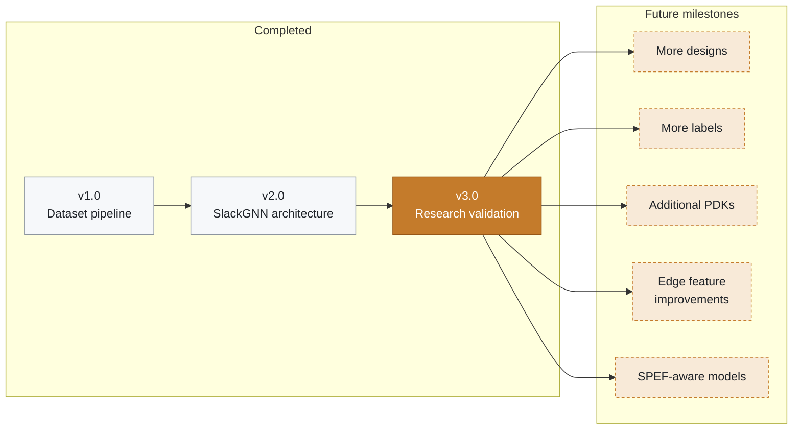

# Roadmap

Completed work is in the tree. Future milestones are the next research increments. They are sequenced so each one can land without rewriting the published six-design table.

## Completed milestones

### Dataset pipeline (v1.0)

- [x] OpenROAD finish import for the curated GCD design
- [x] Timing-report parser, signal-flow graph, and PyTorch Geometric dataset
- [x] Corpus layout under `data/corpus/`

### SlackGNN architecture (v2.0)

- [x] Feature engineering with slack withheld from the encoder
- [x] Attention message passing and multitask violation and slack heads
- [x] GCN, GraphSAGE, and GIN baselines
- [x] Training, metrics, and explainability on the first four designs

### Research validation (v3.0)

- [x] M9.1 Design discovery
- [x] M9.2 Corpus expansion to gcd, aes, ibex, jpeg, riscv32i, and chameleon
- [x] M9.3 Label expansion to 173 route labels
- [x] M9.4 Generalization benchmark
- [x] M9.5 Ablation studies
- [x] M9.6 Robustness analysis
- [x] M9.7 Scaling analysis
- [x] M9.8 Publication figures
- [x] M9.9 Final research report, executive summary, and research highlights
- [x] M9.10 Release preparation: README, index, structure, changelog, roadmap, contributing guide, release notes, and cleanup report

> [!NOTE]
> The published endpoint result is SlackGNN F1 0.8076, ROC-AUC 0.9583, MAE 0.6919 ns, RMSE 0.8667 ns.

## Future milestones

| Milestone | Why it matters | Evidence from v3.0 |
| --- | --- | --- |
| [More designs](#more-designs) | New endpoints, not just bigger graphs | Six designs are the smallest stable corpus |
| [More labels](#more-labels) | Real supervision beyond copied route slack | Collapse at 10% of the expanded labels, stable at 25% |
| [Additional PDKs](#additional-pdks) | Test transfer across cell libraries | Every v3.0 design is sky130hd |
| [Edge feature improvements](#edge-feature-improvements) | Richer structural channels | Edge ablation left ROC-AUC at 0.9583 |
| [SPEF-aware models](#spef-aware-models) | Physical wire delay on each edge | SPEF is imported and unused by the encoder |

### More designs

Add blocks whose finish reports contribute new endpoints. `data/designs.json` already names uart and spi. Those two are absent from the measured corpus. A new design enters through the same pipeline: sky130hd finish, `scripts/process_design.py`, corpus publish, and label expansion. The scaling projection treats a 10-design corpus as about 3.4 minutes of SlackGNN leave-one-design-out training when each added design matches the current average size.

### More labels

Thirty-two published endpoints are enough to rank these four architectures. A larger printed path table is the way to grow supervision. Route copying already lifted training labels from 32 to 173. Further copies of the same reports will not create a new timing measurement. The robustness study collapsed at 10% of the expanded labels and held at 25%.

### Additional PDKs

Every design in v3.0 uses the SkyWater 130 nm high-density platform. A second platform checks whether the structural features transfer when the cell library and the delay scale change. Keep the new PDK in its own leave-one-design-out report so the sky130hd table stays comparable.

### Edge feature improvements

The current edge vector is source type, target type, a fanout proxy for net delay, and the load’s logic depth. Ablating those channels left endpoint ROC-AUC at 0.9583 on this corpus. A later study can test richer structural channels, still without placing slack on the edge.

### SPEF-aware models

Finish SPEF is imported with each design. Resistance and capacitance are withheld from the encoder because the published edge has no SPEF net name to join. A SPEF-aware model would attach those parasitics to the driver-to-load edge and re-run the same holdout. That comparison belongs next to the current fanout proxy, with the leakage rule unchanged: arrival, required, and slack remain targets.
