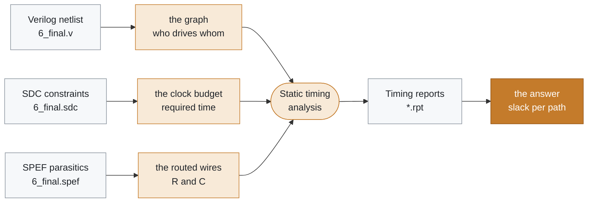
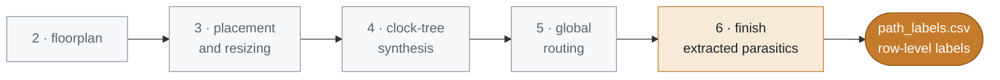

# Dataset structure

<p>
  
  
  
  
</p>

Milestone M1 stores one finished OpenROAD design in a fixed layout. The design is the GCD benchmark, implemented with the sky130hd platform and the `base` RTL-to-GDS flow. Later milestones read these files. This milestone does not parse them into a graph and does not train a model.



<sub>Each artifact answers one part of the timing question. The reports hold the slack a static timing engine computed from the other three.</sub>

## Layout

```text
data/gcd/
    netlist/6_final.v
    sdc/6_final.sdc
    spef/6_final.spef
    reports/*.rpt
```

`scripts/import_gcd_dataset.py` copies those artifacts out of the OpenROAD flow directories. Logs, images, and intermediate `.odb` databases stay in the flow workspace.

## Verilog netlist

`data/gcd/netlist/6_final.v` is a gate-level structural Verilog netlist written at the end of the flow. It declares module `gcd`: ports such as `clk`, `req_msg`, and `resp_msg`, wires for internal nets, and instances of sky130 high-density standard cells (`sky130_fd_sc_hd__*`). Each instance names a cell and connects its pins to nets. There is no RTL behavior left in this file. Placement and routing have already chosen the physical cells.

For timing-slack prediction, the netlist is the circuit graph. Cell instances are the vertices. Nets connect pins and become the edges, or the hyperedges when a net has more than two pins. A graph neural network can only see the design if this connectivity is available. The netlist does not, by itself, say whether a path meets the clock.

## SDC constraints

`data/gcd/sdc/6_final.sdc` is a Synopsys Design Constraints file written by `write_sdc` for `current_design gcd`. It defines the timing question the static timing analysis answered:

- `create_clock -name core_clock -period 1.1000` on port `clk`
- a propagated clock, so latency comes from the clock network rather than an ideal zero
- a virtual clock `vclk_core_clock` with the same 1.1000 period, used as the reference for external delays
- `set_input_delay 0.2200` and `set_output_delay 0.2200` on the request and response ports

Time in this SDC is in nanoseconds, matching the SPEF time unit below. Slack at a flip-flop or an output is the difference between a required time and an arrival time. The period and the external delays set that required time. A model that sees only cells and wires has no clock budget. The constraints are design-level and port-level features for every later slack label.

## SPEF parasitics

`data/gcd/spef/6_final.spef` is an IEEE 1481-1999 Standard Parasitic Exchange Format file written by OpenROAD for design `gcd`. The header in this run records:

- `*T_UNIT 1 NS`
- `*C_UNIT 1 PF`
- `*R_UNIT 1 OHM`
- a `*NAME_MAP` from integers back to net names
- per-net resistance and capacitance for the routed interconnect

After routing, a large share of path delay is wire delay. The SPEF file is the extracted RC for those wires. On the graph built from the netlist, each net can carry the capacitance and resistance of its routed shape as edge features. Logical connectivity alone cannot tell a short local wire from a long routed net, and those two nets produce different slack.

## Timing reports

`data/gcd/reports/` receives every file in the OpenROAD reports directory whose name ends in `.rpt`. In this flow those reports are stage timing summaries plus one physical-verification report:

| Report | What it records |
| --- | --- |
| `2_floorplan_final.rpt` | Total negative slack, worst negative slack, worst slack, minimum clock period, skew, and path checks after floorplan |
| `3_global_place.rpt`, `3_detailed_place.rpt`, `3_resizer.rpt` | The same timing metrics during placement and gate resizing |
| `4_cts_final.rpt` | The same metrics after clock-tree synthesis |
| `5_global_route.rpt` | The same metrics after global routing |
| `6_finish.rpt` | The same metrics on the finished design, with extracted parasitics |
| `5_route_drc.rpt` | Empty in this run |
| `5_route_drc.rpt-5.rpt` | Metal short violations from detailed routing. The importer copies it because the name ends in `.rpt` |

A path check lists fanout, capacitance, slew, delay, and arrival time at each pin, then the required time and the slack. Slack that meets the constraint is reported as `slack (MET)`. Negative slack is a violation. `6_finish.rpt` in this run reports total negative slack `-64.94`, worst negative slack `-1.46`, and worst slack `-1.46` for the maximum (setup) analysis. Those numbers are nanoseconds in this sky130hd flow. `scripts/parse_timing_report.py` reads each finish path check into `data/gcd/parsed/path_labels.csv`. `scripts/dataset_summary.py` writes `data/gcd/parsed/dataset_summary.json`. The earlier stage reports show how that slack moved from floorplan through placement, clock-tree synthesis, and routing. They are context for the same design, not a second dataset.



> [!NOTE]
> Total negative slack and worst negative slack summarize the whole design. They are useful checks on a prediction, and they are too coarse to supervise a per-pin graph model by themselves. The path tables are the row-level labels.

## Why the four artifacts stay together

Timing slack is a property of a path through a physical netlist under a clock constraint and a parasitic annotation.

- The netlist supplies the graph.
- The SDC supplies the clock period and the external delays that define required time.
- The SPEF supplies the routed RC that moves arrival time.
- The reports supply the slack a static timing engine computed from those three.

Slack labels for the printed finish paths are in `data/gcd/parsed/`. The flattened gate-level signal-flow graph is in `data/gcd/graphs/netlist_graph.pkl`. `data/gcd/dataset/` is that graph with each path slack stored on its endpoint. `data/gcd/pyg/graph.pt` is the same connectivity as a PyTorch Geometric graph with one-hot node type and endpoint slack. `data/designs.json` names every benchmark, and `data/corpus/` collects one `graph.pt` and `metadata.json` per design that passes the corpus checks. `scripts/process_design.py <design>` runs parsing, graph extraction, labeling, and PyG conversion for one design that already has a netlist and a finish report. A graph neural network is a later milestone. It reads this corpus and does not replace it.
