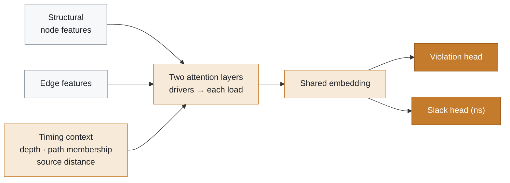

# SlackGNN executive summary

  
  
  
  
  

> [!TIP]
> **In one sentence.** Trained on the reported paths of five OpenROAD designs, SlackGNN ranks and estimates endpoint slack on the sixth better than GCN, GraphSAGE, or GIN, and the gain comes from knowing which gates lie on reported paths and how deep they sit in the logic.

SlackGNN predicts timing slack on placed-and-routed digital netlists. It reads a directed gate-level graph, estimates whether an endpoint violates its clock constraint, and estimates the slack in nanoseconds. The study uses six OpenROAD designs on the SkyWater 130 nm high-density platform: gcd, aes, ibex, jpeg, riscv32i, and chameleon. Together they contain 79,856 nodes, 189,028 edges, 32 published timing endpoints, and 173 expanded route labels.

The evaluation is leave-one-design-out. Each design is held out once. Training uses the other designs. Test scores use the published path-table slack of the held-out design. Arrival time, required time, and slack are supervision targets. They are withheld from the encoder.

## Result

On published endpoints, SlackGNN is the strongest of the four models trained under this protocol.

| Model | F1 ↑ | ROC-AUC ↑ | MAE (ns) ↓ | RMSE (ns) ↓ |
| --- | ---: | ---: | ---: | ---: |
| GCN | 0.5800 | 0.6243 | 0.9621 | 1.1922 |
| GraphSAGE | 0.3333 | 0.7632 | 0.8704 | 1.1053 |
| GIN | 0.5222 | 0.6951 | 0.9470 | 1.1712 |
| **SlackGNN** | **0.8076** | **0.9583** | **0.6919** | **0.8667** |

  
  

SlackGNN records the best endpoint F1, the best ROC-AUC, and the best slack error. The same ordering holds for ROC-AUC and mean absolute error on the expanded route labels. aes is the easiest holdout. ibex is the hardest.

> [!IMPORTANT]
> These numbers are a corpus measurement. Each held-out design has four to seven published endpoints. A single endpoint can move F1. The result is evidence that the architecture transfers across these six netlists. It is a timing-signoff result only after a static timing engine has checked the design.

## What the model uses

Each node is an input, output, register, or combinational gate. Each edge runs from a driver to a load. SlackGNN adds three inputs the baselines do not use together: structural node features, edge features, and a timing context of logic depth, reported-path membership, and source distance. Two attention layers aggregate driver messages into each load. One shared embedding feeds a violation head and a slack head.

The useful pieces, measured by removing them, are path membership and timing criticality. Removing path membership is the only ablation that lowers both endpoint F1 and slack error. Removing logic depth and source distance does the most damage to ranking and to slack error: ROC-AUC falls from 0.9583 to 0.8722, and MAE rises to 0.7360 ns. Attention contributes to ranking. Edge features, which are a fanout proxy in this corpus, leave endpoint ROC-AUC unchanged when removed.

## How far the result extends

SlackGNN remains ahead of GCN, GraphSAGE, and GIN when labels are thinned, noised, or drawn from fewer reported paths. Performance holds through 25% of the expanded labels and through 20% label noise. It holds when half of the training paths are removed. It collapses at 10% labels, where F1 falls to 0.6143, ROC-AUC falls to 0.7264, and MAE rises to 0.9282 ns. Six designs are the smallest corpus that stays within 0.05 F1 and 0.10 ns MAE of the published result. Four designs are past the failure line on slack error.

| Stress | Holds | Breaks |
| --- | --- | --- |
| Fewer labels | through 25% of the expanded labels | at 10% labels |
| Label noise | through 20% noise | no tested setting |
| Fewer reported paths | with half of the training paths removed | no tested setting |
| Fewer designs | six designs | four designs, on slack error |

Training time follows edge count more closely than node count, label count, or the logarithmic alternatives that were fit. jpeg, the largest netlist, accounts for about 38% of a SlackGNN epoch, and the backward pass is the heavier part. A full six-design holdout is about 1.1 minutes on the measured CPU. A linear projection to 50 average-sized designs is about 92 minutes if every fold still runs 20 epochs. The measured log-log slope against edges is 0.45, so a fixed per-step cost is still visible between gcd and jpeg.

## Who this is for

**EDA engineers** can treat SlackGNN as a fast screen for which unseen blocks look timing-critical before a full path report is read. The screen is trained on reported paths from related blocks. It becomes useful when a new design brings new endpoints. A larger netlist with the same handful of printed paths does not, by itself, stress the model.

**ML engineers** can treat the release as a reproducible graph-learning benchmark: directed netlists, a leakage rule that keeps slack out of the input, a design holdout, and published tables for generalization, ablation, robustness, and scaling. GraphSAGE is the fastest baseline. SlackGNN spends more time per step and returns the accuracy the study was built to measure.

**Hiring managers** can read the work as an end-to-end ML-for-EDA project: an OpenROAD corpus, a graph dataset, a multitask model, controlled ablations, and an explicit statement of what the evidence does not support. The repository documents the pipeline from finish netlist and timing report through PyTorch Geometric graphs to the holdout numbers above.

---

Figures for a talk or a repository page are in `reports/figures/publication/`. The full paper is `docs/slackgnn_final_research_report.md`.
