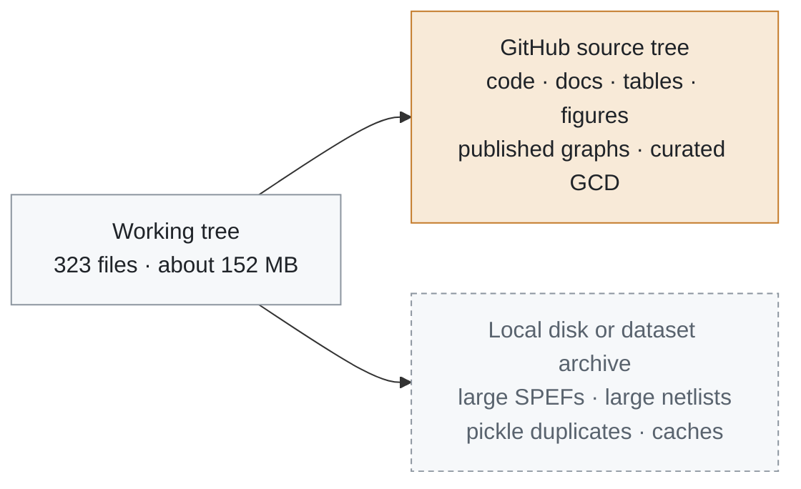

# Repository cleanup report

  
  
  
  

Survey date: 13 October 2026. The working tree holds 323 files and about 152 MB outside `.git`, caches, and virtual environments. This report recommends what a public GitHub source tree should carry. It removes nothing.

The current `.gitignore` already keeps most bulky design dumps untracked. The recommendations below match that policy and name the exceptions a release should keep.

## Size by top-level directory

| Directory | Files | Size |
| --- | ---: | ---: |
| `data/` | 101 | 141.7 MB |
| `reports/` | 100 | 9.9 MB |
| `src/` | 50 | 0.5 MB |
| `docs/` | 11 | 0.1 MB |
| `tests/` | 18 | 0.1 MB |
| `scripts/` | 30 | under 0.1 MB |
| `notebooks/`, `results/`, `tcl/` | markers | under 0.1 MB |

## What belongs in the GitHub source tree

| Path | Why it stays |
| --- | --- |
| `src/`, `scripts/`, `tests/`, `pyproject.toml`, `requirements.txt` | The library and the commands that reproduce the studies |
| `docs/`, `README.md`, `CHANGELOG.md`, `ROADMAP.md`, `CONTRIBUTING.md` | The release narrative |
| `reports/*.md`, `reports/*.json` except regenerated prediction dumps | Published tables |
| `reports/figures/publication/`, `reports/figures/robustness/`, `reports/figures/scaling/`, `reports/figures/ablation_f1_mae.png` | Figures cited by the paper and the README |
| `reports/m9/expanded_labels.pt` (0.8 MB) | Training target the six-design scripts load. `*.pt` currently ignores it. A release that retrains from git needs an exception for this file |
| `data/corpus/` (4.9 MB) | Published PyG graphs. `data/corpus/**/graph.pt` is already allowed |
| `data/designs.json` | Discovery list |
| `data/gcd/` (0.8 MB) | Curated example: netlist 0.05 MB, SPEF 0.40 MB, reports, and `pyg/graph.pt`. Already allowed |

> [!NOTE]
> `docs/assets/` was added after this survey. It holds the README banner and the architecture figure (PNG renders plus SVG sources, under 1 MB together) and belongs in the source tree with the rest of `docs/`.

## Files that stay outside GitHub

These are generated or duplicated, and they dominate the disk. `.gitignore` already excludes `data/*` other than `designs.json`, `data/gcd/`, and `data/corpus/`, and it excludes `*.spef` other than the GCD SPEF, `*.pt` other than the published graphs, and `results/*`.

### SPEF parasitics — 106.3 MB across six files

| File | Size |
| --- | ---: |
| `data/jpeg/spef/6_final.spef` | 39.25 MB |
| `data/ibex/spef/6_final.spef` | 22.70 MB |
| `data/aes/spef/6_final.spef` | 20.10 MB |
| `data/chameleon/spef/6_final.spef` | 15.90 MB |
| `data/riscv32i/spef/6_final.spef` | 7.97 MB |
| `data/gcd/spef/6_final.spef` | 0.40 MB |

Keep the five large SPEFs on the local disk or in a separate dataset archive. The GCD SPEF is small enough to remain with the curated example. The v3.0 encoder does not read SPEF, so the source release can still retrain once graphs and expanded labels are present. A SPEF-aware follow-up is the point at which these files need a distribution plan, such as a release asset, rather than a commit.

### Gate-level netlists

| File | Size | Recommendation |
| --- | ---: | --- |
| `data/jpeg/netlist/6_final.v` | 5.19 MB | Outside the source tree |
| `data/ibex/netlist/6_final.v` | 2.07 MB | Outside the source tree |
| `data/aes/netlist/6_final.v` | 1.68 MB | Outside the source tree |
| `data/riscv32i/netlist/6_final.v` | under 1 MB | Outside the source tree. Same class of generated Verilog |
| `data/chameleon/netlist/6_final.v` | under 1 MB | Outside the source tree |
| `data/gcd/netlist/6_final.v` | 0.05 MB | Keep with the curated GCD example |

### Derived graphs that duplicate `data/corpus/`

| Kind | Count | Size | Recommendation |
| --- | ---: | ---: | --- |
| `*.pkl` labeled graphs and NetworkX pickles | 12 | 14.9 MB | Outside. Rebuild with `scripts/extract_graph.py` and `scripts/build_dataset.py` |
| `data/<design>/pyg/graph.pt` | 6 | about 4.9 MB, matching the corpus | Outside for every design except gcd. `data/corpus/<design>/graph.pt` is the published copy |
| `reports/training_data.pt` | 1 | 4.86 MB | Outside. `scripts/train.py` rebuilds it. Already ignored by `*.pt` |

The largest duplicate pairs are jpeg (`labeled_graph.pkl` 3.45 MB, `netlist_graph.pkl` 3.20 MB, `pyg/graph.pt` 2.16 MB) and ibex (1.83 MB, 1.71 MB, 1.13 MB).

### Other generated artifacts

| Path | Recommendation |
| --- | --- |
| `__pycache__/`, `.pytest_cache/`, `*.egg-info/` | Outside. Already ignored |
| `.venv/` | Outside. Already ignored |
| `results/` contents | Outside. Already ignored except `.gitkeep` |
| Waveforms (`*.vcd`, `*.fsdb`, `*.saif`) | Outside. Already ignored. None are in the tree today |
| `reports/m9/` JSON and Markdown from the four-design run | Optional. About 0.5 MB after the labels tensor. Safe to publish as history. Label them as the earlier experiment so they are read beside the six-design tables |

Per-design directories on disk:

| Directory | Size | In the source tree |
| --- | ---: | --- |
| `data/jpeg/` | 53.3 MB | Finish files stay local. Corpus graph stays |
| `data/ibex/` | 29.6 MB | Finish files stay local. Corpus graph stays |
| `data/aes/` | 25.7 MB | Finish files stay local. Corpus graph stays |
| `data/chameleon/` | 17.2 MB | Finish files stay local. Corpus graph stays |
| `data/riscv32i/` | 10.3 MB | Finish files stay local. Corpus graph stays |
| `data/gcd/` | 0.8 MB | Keep |
| `data/corpus/` | 4.9 MB | Keep |

## Release checklist

- [ ] Confirm `git status` shows no `data/aes`, `data/ibex`, `data/jpeg`, `data/riscv32i`, or `data/chameleon` SPEF or netlist.
- [ ] Add a gitignore exception for `reports/m9/expanded_labels.pt` if the public tree should retrain without a separate download.
- [ ] Add the publication, robustness, and scaling PNGs. They are about 2.7 MB under `reports/figures/`.
- [ ] Add a `LICENSE` file before the first public push. None is present.
- [ ] Point the README at the six-design table. `README_M9.md` remains the four-design record.

> [!NOTE]
> No file was deleted while writing this report.
