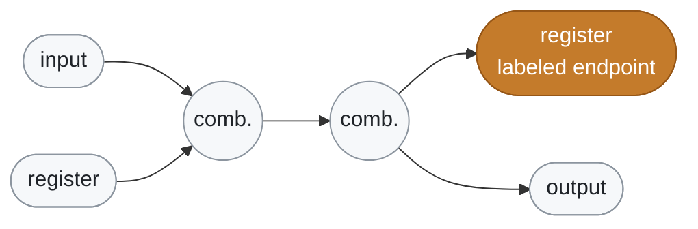
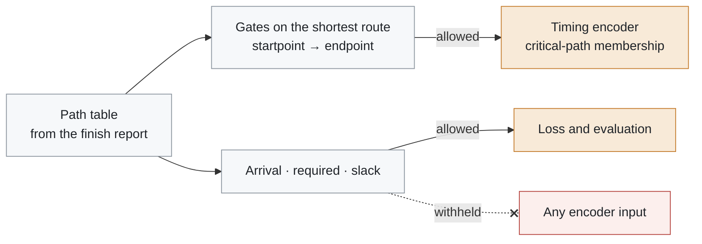
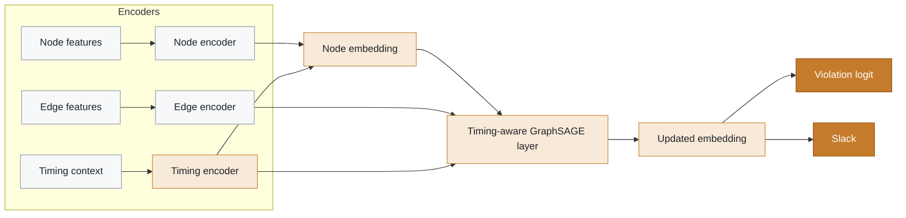
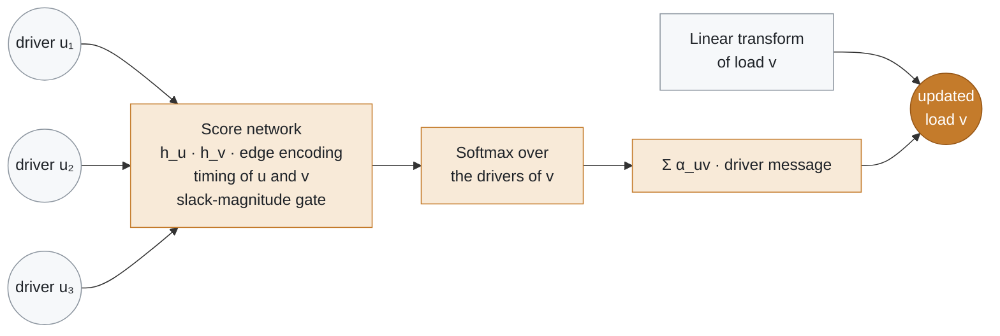
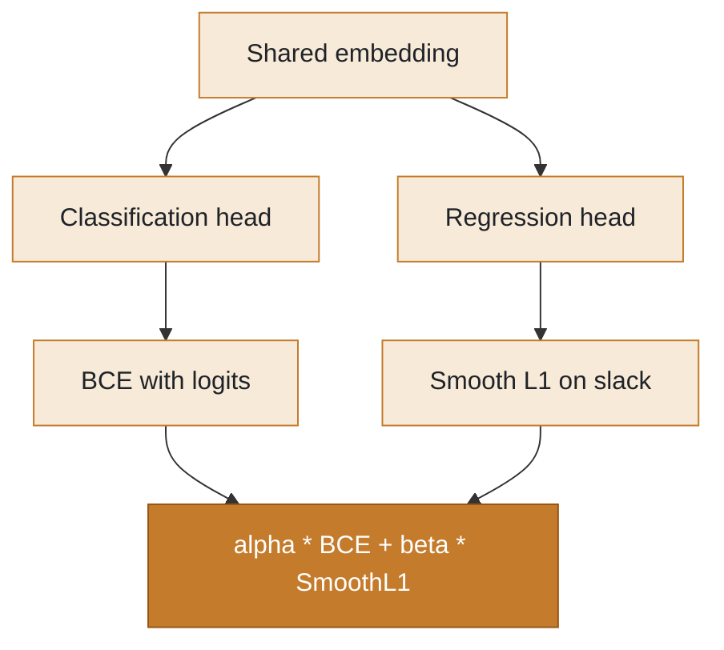

# SlackGNN architecture

<p>
  
  
  
</p>

SlackGNN is a node-level timing model on the published signal-flow graph. It predicts two values at each labeled endpoint: whether timing is violated, and the slack in nanoseconds. Message passing still runs on the full netlist so unlabeled gates can carry structural context.

<p align="center">
  <picture>
    <source media="(prefers-color-scheme: dark)" srcset="assets/architecture-dark.png">
    
  </picture>
</p>

**On this page:** [Problem formulation](#problem-formulation) · [Node features](#node-features) · [Edge features](#edge-features) · [Timing features](#timing-features) · [Message passing](#message-passing) · [Loss functions](#loss-functions) · [Multi-task learning](#multi-task-learning)

---

## Problem formulation

Each design is a directed graph. A node is an input, output, register, or combinational gate. An edge goes from the driver of a net to each load. A small set of endpoints has a slack label from the OpenROAD finish report.

For a labeled endpoint \(v\):

- classification target \(y_v = 1\) when slack is negative, and \(y_v = 0\) when slack meets the constraint
- regression target \(s_v\) is that slack in nanoseconds

Unlabeled nodes are used for message passing and are excluded from the loss. Evaluation is leave-one-design-out: the held-out design contributes no training labels.



<sub>Edges run driver → load. Every node takes part in message passing. Only labeled nodes enter the loss.</sub>

## Node features

The encoder reads a normalized structural vector:

| Channel | Meaning |
| --- | --- |
| gate type | one-hot input, output, register, combinational |
| register flag | 1 for a sequential cell |
| fanin, fanout | driver and load counts |
| logic depth | longest hop count from an input or register, reset at the next register |
| in-degree, out-degree | the same counts on this signal-flow graph |

Published nodes do not store a standard-cell name, so gate type is the four-way class already in `graph.pt`. Fanin equals in-degree and fanout equals out-degree because each edge is one driver-to-load connection.

## Edge features

| Channel | Meaning |
| --- | --- |
| connection type | one-hot source class and one-hot target class |
| net delay | structural proxy, `log1p(driver fanout)` normalized inside the design |
| topological distance | normalized logic depth of the load |

> [!NOTE]
> The published edge does not store a SPEF net name, so resistance and capacitance are not joined. The delay channel is the fanout proxy above.

## Timing features

The path table supplies arrival time, required time, slack, and the gates on a shortest signal-flow route from each reported startpoint to its endpoint. That route is the critical-path membership used by the model.

Arrival time, required time, and slack are the supervision targets. They are stored for evaluation and explainability, and they are withheld from the encoder. Putting them on the endpoint would let the network read the answer. The timing encoder instead receives:

- normalized logic depth, a structural stand-in for timing criticality
- critical-path membership
- source distance, the same normalized depth measured from an input or register

Attention also sees a learned slack-magnitude gate, which is a function of the node embedding and not the ground-truth slack.



> [!IMPORTANT]
> **Leakage rule.** Arrival time, required time, and slack never reach an encoder. Membership says a node lies on a reported route. It does not say the sign or the magnitude of that route's slack.

## Message passing



Each layer aggregates drivers into their loads:

1. A score network reads the driver embedding, the load embedding, the edge encoding, both timing encodings, and the learned slack magnitude.
2. Scores are softmax-normalized over the drivers of each load.
3. The load embedding is a linear transform of itself plus the attention-weighted driver messages.



Two layers are the default. Hidden size and dropout are configurable.

## Loss functions

The classification head is trained with `BCEWithLogitsLoss` and a positive weight equal to the number of timing-met training labels divided by the number of violations.

The regression head is trained with `SmoothL1Loss` on slack in nanoseconds.

## Multi-task learning

Both heads share the embedding. The joint objective is

```text
total = alpha * classification_loss + beta * regression_loss
```

`alpha` and `beta` default to 1 and 0.5. The same network can be trained with only the classification term, only the regression term, or the joint loss. Leave-one-design-out rotates `gcd`, `aes`, `ibex`, and `jpeg`.

> [!NOTE]
> That rotation is the earlier four-design experiment. The published v3.0 protocol holds out each of the six designs in turn. Its scores are in [slackgnn_final_research_report.md](slackgnn_final_research_report.md#6-experimental-setup).


