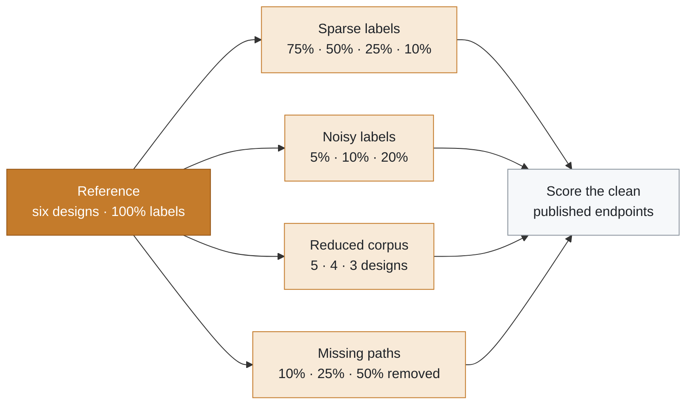

# SlackGNN robustness analysis

  
  
  
  

Four ways to starve the model, each repeated for GCN, GraphSAGE, GIN, and SlackGNN under the same leave-one-design-out protocol. The held-out endpoints always keep their published slack.

**On this page:** [Setup](#experimental-setup) · [Sparse labels](#sparse-labels) · [Noisy labels](#noisy-labels) · [Reduced corpus](#reduced-corpus) · [Missing paths](#missing-paths) · [Failure thresholds](#failure-thresholds) · [Most resilient architecture](#most-resilient-architecture) · [Recommendations](#recommended-future-improvements)

## Experimental setup

Each condition trains GCN, GraphSAGE, GIN, and SlackGNN with one design held out. The loss uses expanded route labels from the other designs. Accuracy, precision, recall, F1, and ROC-AUC score the violation class. MAE and RMSE score slack in nanoseconds. The held-out endpoints keep their published slack, including when training paths or labels are removed. Baselines keep separate classification and regression heads on the one-hot node type. SlackGNN keeps the multitask loss. Hidden width is 32, the epoch cap is 20, and patience is 6. The seed is 0.

Sparse labels keep a class-balanced fraction of the training and validation pool, then hold out one label per class again. Noise flips that fraction of training classes and adds Gaussian noise whose standard deviation is the same fraction of the training slack spread. Reduced corpora are prefixes of gcd, aes, ibex, jpeg, riscv32i, chameleon. Missing paths drop that fraction of mapped routes on the training designs and relabel nodes from the routes that remain. At least one route stays.

## Dataset statistics

Designs: 6. Nodes: 79856. Edges: 189028. Expanded labels: 173. Published endpoints: 32.

## Robustness results

Each condition below is one slice of the published robustness table. Within each setting, the best value in a column is in bold. `n/a` marks an undefined F1 mean: the model predicted no violations on every holdout in that setting.

### Sparse labels

| Setting | Model | F1 ↑ | ROC-AUC ↑ | MAE (ns) ↓ | RMSE (ns) ↓ |
| --- | --- | ---: | ---: | ---: | ---: |
| 100% labels | GCN | 0.5800 | 0.6243 | 0.9621 | 1.1922 |
|  | GraphSAGE | 0.3333 | 0.7632 | 0.8704 | 1.1053 |
|  | GIN | 0.5222 | 0.6951 | 0.9470 | 1.1712 |
|  | **SlackGNN** | **0.8076** | **0.9583** | **0.6919** | **0.8667** |
| 75% labels | GCN | 0.5508 | 0.5549 | 0.9401 | 1.1295 |
|  | GraphSAGE | 0.6000 | 0.7215 | 0.9108 | 1.1123 |
|  | GIN | 0.4838 | 0.6951 | 0.9083 | 1.1143 |
|  | **SlackGNN** | **0.8267** | **0.8847** | **0.8221** | **0.9959** |
| 50% labels | GCN | 0.4917 | 0.5535 | 1.0109 | 1.2312 |
|  | GraphSAGE | n/a | 0.6104 | 0.9100 | 1.1286 |
|  | GIN | 0.4944 | 0.6424 | 0.9625 | 1.1838 |
|  | **SlackGNN** | **0.8778** | **0.9181** | **0.7771** | **0.9514** |
| 25% labels | GCN | 0.6333 | 0.5243 | 0.9304 | 1.1264 |
|  | GraphSAGE | 0.4500 | 0.4688 | 1.0047 | 1.2486 |
|  | GIN | 0.5417 | 0.5799 | 1.0635 | 1.3069 |
|  | **SlackGNN** | **0.8250** | **0.8097** | **0.7930** | **0.9557** |
| 10% labels | GCN | 0.4815 | 0.4938 | 0.9825 | 1.1670 |
|  | GraphSAGE | 0.4508 | 0.5701 | 1.0339 | 1.2753 |
|  | GIN | 0.5371 | 0.6826 | 1.0840 | 1.2950 |
|  | **SlackGNN** | **0.6143** | **0.7264** | **0.9282** | **1.1551** |

### Noisy labels

| Setting | Model | F1 ↑ | ROC-AUC ↑ | MAE (ns) ↓ | RMSE (ns) ↓ |
| --- | --- | ---: | ---: | ---: | ---: |
| 5% noise | GCN | 0.5111 | 0.6660 | 0.9649 | 1.1950 |
|  | GraphSAGE | 0.5714 | 0.7215 | 0.8773 | 1.1124 |
|  | GIN | 0.4933 | 0.7076 | 0.9830 | 1.1939 |
|  | **SlackGNN** | **0.8833** | **0.9097** | **0.6778** | **0.8616** |
| 10% noise | GCN | 0.5111 | 0.5201 | 0.9697 | 1.1997 |
|  | GraphSAGE | 0.4167 | 0.6479 | 0.8738 | 1.1114 |
|  | GIN | 0.4611 | 0.6326 | 0.9670 | 1.1812 |
|  | **SlackGNN** | **0.7533** | **0.9097** | **0.7616** | **0.9558** |
| 20% noise | GCN | 0.4083 | 0.3410 | 0.9780 | 1.2092 |
|  | GraphSAGE | 0.6190 | 0.6660 | 0.8830 | 1.1212 |
|  | GIN | 0.6000 | 0.5840 | 0.9590 | 1.1680 |
|  | **SlackGNN** | **0.8200** | **0.9514** | **0.7497** | **0.9517** |

### Reduced corpus

| Setting | Model | F1 ↑ | ROC-AUC ↑ | MAE (ns) ↓ | RMSE (ns) ↓ |
| --- | --- | ---: | ---: | ---: | ---: |
| 6 designs | GCN | 0.5800 | 0.6243 | 0.9621 | 1.1922 |
|  | GraphSAGE | 0.3333 | 0.7632 | 0.8704 | 1.1053 |
|  | GIN | 0.5222 | 0.6951 | 0.9470 | 1.1712 |
|  | **SlackGNN** | **0.8076** | **0.9583** | **0.6919** | **0.8667** |
| 5 designs | GCN | 0.6417 | 0.5200 | 1.1089 | 1.3966 |
|  | GraphSAGE | n/a | 0.7133 | 0.9901 | 1.2283 |
|  | GIN | 0.5267 | 0.6967 | 0.9979 | 1.2488 |
|  | **SlackGNN** | **0.8667** | **1.0000** | **0.8377** | **1.0083** |
| 4 designs | GCN | 0.4750 | 0.6708 | 1.1020 | 1.3713 |
|  | GraphSAGE | 0.4857 | 0.6875 | 1.1538 | 1.4243 |
|  | GIN | 0.5037 | 0.6417 | 1.0526 | 1.3202 |
|  | **SlackGNN** | **0.6750** | **0.9500** | **0.9890** | **1.1962** |
| 3 designs | GCN | 0.3667 | 0.4056 | 1.1505 | 1.3882 |
|  | GraphSAGE | 0.6667 | 0.6167 | 1.1062 | 1.3631 |
|  | GIN | 0.5222 | 0.5889 | 1.2094 | 1.5007 |
|  | **SlackGNN** | **0.7333** | **0.9667** | **0.9011** | **1.0263** |

### Missing paths

| Setting | Model | F1 ↑ | ROC-AUC ↑ | MAE (ns) ↓ | RMSE (ns) ↓ |
| --- | --- | ---: | ---: | ---: | ---: |
| 10% paths removed | GCN | 0.4083 | 0.6104 | 0.9817 | 1.2296 |
|  | GraphSAGE | 0.3333 | 0.7215 | 0.9174 | 1.1230 |
|  | GIN | 0.3838 | 0.6049 | 1.0247 | 1.2529 |
|  | **SlackGNN** | **0.8133** | **0.9514** | **0.7272** | **0.8737** |
| 25% paths removed | GCN | 0.3743 | 0.6437 | 1.0209 | 1.2511 |
|  | GraphSAGE | 0.5357 | 0.7146 | 0.9365 | 1.1819 |
|  | GIN | 0.4706 | 0.6465 | 1.0519 | 1.3044 |
|  | **SlackGNN** | **0.8400** | **0.9722** | **0.7094** | **0.8806** |
| 50% paths removed | GCN | 0.5714 | 0.5438 | 1.0319 | 1.2380 |
|  | GraphSAGE | 0.3889 | 0.7049 | 0.9577 | 1.1640 |
|  | GIN | 0.5407 | 0.6257 | 1.0546 | 1.2717 |
|  | **SlackGNN** | **0.9000** | **0.9236** | **0.7210** | **0.9085** |

## Failure thresholds

> [!WARNING]
> **Collapse rule.** Endpoint F1 falls more than 0.10 below the full-data SlackGNN result, ROC-AUC falls below 0.80, or MAE rises more than 0.15 ns.

- Sparse labels: 10% labels.
- Noisy labels: no tested setting crosses the collapse rule.
- Reduced corpus: 4 designs.
- Missing paths: no tested setting crosses the collapse rule.

## Most resilient architecture

Most robust model on the degraded conditions: slackgnn.
Least robust model: graphsage.

| Model | Mean degraded F1 | Worst F1 | Mean degraded MAE (ns) |
| --- | ---: | ---: | ---: |
| gcn | 0.4942 | 0.3667 | 1.0133 |
| graphsage | 0.4245 | 0.0000 | 0.9658 |
| gin | 0.5046 | 0.3838 | 1.0245 |
| **slackgnn** | **0.8022** | **0.6143** | **0.7996** |

SlackGNN stays ahead of every baseline on F1 and MAE for: sparse_labels: 100% labels, sparse_labels: 75% labels, sparse_labels: 25% labels, sparse_labels: 10% labels, noisy_labels: 5% noise, noisy_labels: 10% noise, noisy_labels: 20% noise, reduced_corpus: 6 designs, reduced_corpus: 4 designs, reduced_corpus: 3 designs, missing_paths: 10% paths removed, missing_paths: 25% paths removed, missing_paths: 50% paths removed.

## Recommended future improvements

- Treat 6 designs as the smallest corpus that stays within 0.05 F1 and 0.10 ns MAE of the six-design SlackGNN result.
- Sparse-label threshold: 10% labels. Scaling should add reported endpoints before relying on copied route labels alone.
- Noise threshold: no tested setting crosses the collapse rule. A scaling run should keep the published endpoint slack untouched and record label noise separately.
- Missing-path threshold: no tested setting crosses the collapse rule. The next scaling design is useful when its finish report contributes new endpoints, not only a larger netlist.
- Compare new designs against slackgnn as the current robust reference and against graphsage as the weak reference.
