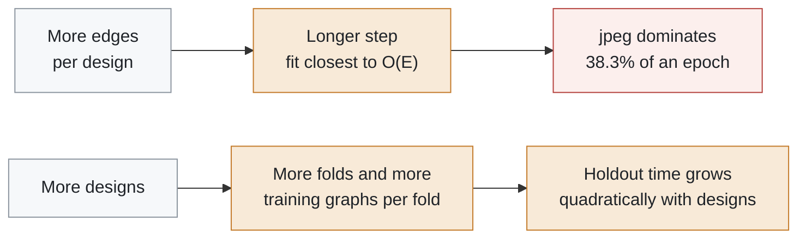

# SlackGNN scaling analysis

  
  
  
  

> [!TIP]
> **The short version.** Training time grows with edge count. jpeg, the largest netlist, is both the runtime and the memory bottleneck. SlackGNN costs about twice the baseline protocol time and buys the best published accuracy.

## Experimental setup

Each model is timed on one published design at a time. Hidden width is 32. Each timing entry is the median of 3 steps after a warmup step. GCN, GraphSAGE, and GIN use the one-hot node type. SlackGNN uses node, edge, and timing features. The published accuracy comes from the six-design leave-one-design-out generalization run. This study does not retrain that comparison.

Epoch time is the median of repeated single-design steps after one warmup. A published leave-one-design-out run visits every other design once per epoch. Baseline protocol time counts the separate classification and regression heads. Accuracy is the published endpoint mean from the generalization report.

## Dataset statistics

| Dataset | Nodes | Edges | Labels | Disk size (MB) | PyG graph (MB) | Dataset (MB) |
| --- | ---: | ---: | ---: | ---: | ---: | ---: |
| gcd | 527 | 928 | 27 | 0.77 | 0.03 | 0.05 |
| aes | 15868 | 38215 | 20 | 25.71 | 0.98 | 1.49 |
| ibex | 18000 | 44436 | 42 | 29.57 | 1.13 | 1.84 |
| **jpeg** | **36283** | **82643** | 23 | **53.30** | **2.16** | **3.45** |
| riscv32i | 5997 | 15884 | 33 | 10.32 | 0.40 | 0.60 |
| chameleon | 3181 | 6922 | 28 | 17.17 | 0.19 | 0.31 |

## Runtime scaling

| Model | Training time (s) | Inference time (s) | PyTorch step (MB) | F1 | ROC-AUC | MAE (ns) |
| --- | ---: | ---: | ---: | ---: | ---: | ---: |
| gcn | 29.39 | 0.0428 | 14.37 | 0.5800 | 0.6243 | 0.9621 |
| graphsage | 26.21 | 0.0253 | 19.60 | 0.3333 | 0.7632 | 0.8704 |
| gin | 43.84 | 0.0306 | 19.33 | 0.5222 | 0.6951 | 0.9470 |
| **slackgnn** | 67.61 | 0.1647 | 50.97 | **0.8076** | **0.9583** | **0.6919** |

Training time follows O(E) most closely among O(N), O(E), O(N log N), and O(E log N). The mean log-log slope against edges is 0.45.

## Memory scaling

| Model | Parameters (KB) | Dataset tensors (MB) | PyTorch step (MB) | Working set (MB) |
| --- | ---: | ---: | ---: | ---: |
| gcn | 0.8 | 18.9 | 14.37 | 467.7 |
| graphsage | 1.4 | 18.9 | 19.60 | 467.8 |
| gin | 13.4 | 18.9 | 19.33 | 468.1 |
| slackgnn | 21.8 | 18.9 | 50.97 | 709.5 |

Dataset tensor bytes track the netlist. PyTorch step memory is parameters plus forward activations and gradients. The process working set includes every loaded design.

## Inference scaling

| Model | Batch inference (s) | Nodes per second | Labeled predictions per second |
| --- | ---: | ---: | ---: |
| gcn | 0.0428 | 1863852 | 4038 |
| graphsage | 0.0253 | 3151742 | 6828 |
| gin | 0.0306 | 2613029 | 5661 |
| slackgnn | 0.1647 | 484882 | 1050 |

## Growth projections

Each added design matches the current mean node, edge, label, and disk size. Training still steps one graph at a time.

| Designs | Nodes | Edges | Labels | Disk (MB) | SlackGNN training (min) |
| ---: | ---: | ---: | ---: | ---: | ---: |
| 6 | 79856 | 189028 | 173 | 136.8 | 1.1 |
| 10 | 133093 | 315047 | 288 | 228.1 | 3.4 |
| 20 | 266187 | 630093 | 577 | 456.1 | 14.3 |
| 50 | 665467 | 1575233 | 1442 | 1140.3 | 92.0 |

> [!NOTE]
> Projections assume every added design is average-sized. A future jpeg-sized design costs more than that average, and a gcd-sized design costs less.

## Bottlenecks

> [!WARNING]
> Largest runtime bottleneck: jpeg (38.3% of a SlackGNN epoch). The heavier pass is backward.
> Largest memory bottleneck: jpeg PyTorch step, 50.97 MB.

| Question | Answer |
| --- | --- |
| Fastest model | graphsage |
| Most efficient model by seconds per edge | graphsage |
| Best published F1 per projected training second | gcn |

## Recommendations

- M9.8 should plot training time against edges and mark jpeg as the runtime bottleneck. The fitted behavior is O(E).
- M9.9 should report peak step memory on jpeg separately from corpus disk growth. Accuracy stays the published six-design holdout, and this study does not replace it.
- M9.10 should publish the scaling JSON and figures, keep generated netlists out of the source archive, and document graphsage as the fastest model, graphsage as the lowest seconds per edge, and gcn as the best published F1 per projected training second.
